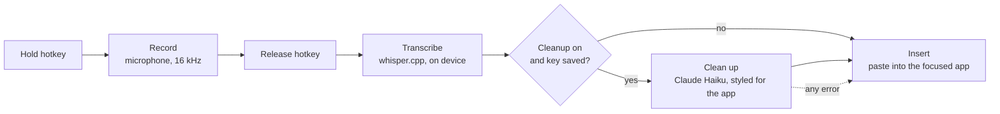

# Utter

Free, open-source voice dictation for macOS. Hold a hotkey, speak, release, and
cleaned-up text appears in whatever app is focused.

- **Runs on your Mac.** Speech is transcribed locally with
  [whisper.cpp](https://github.com/ggml-org/whisper.cpp). Audio never leaves the machine.
- **Bring your own key, or none.** Add an Anthropic API key to have Claude tidy
  each dictation. Without a key, Utter inserts the raw transcription.
- **Fits the app you are in.** A chat message, an email and a code comment each
  get a different writing style.

Inspired by voice dictation tools. MIT licensed.

## How it works



1. **Hotkey.** `⌃ ⌥ Space` by default. Change it in settings.
2. **Record.** The microphone is open only while the key is held.
3. **Transcribe.** A Whisper model runs on your Mac, using the GPU through Metal.
4. **Clean up (optional).** The transcript goes to the Claude API with a prompt
   that removes filler words, fixes punctuation, and matches the app you are
   typing in. If this step fails for any reason, the raw transcript is used.
5. **Insert.** Utter puts the text on the clipboard, presses `⌘V`, and then puts
   your previous clipboard back.

## Install

There is no signed download yet, so the recommended route is to build it
yourself. The first build takes several minutes, nearly all of it compiling.

### You need

- macOS 12 or later. Built and tested on Apple Silicon; Intel is untested.
- Xcode Command Line Tools: `xcode-select --install`
- [Rust](https://rustup.rs)
- Node.js 20 or later, with pnpm (`corepack enable`)
- CMake: `brew install cmake`

### Build

```bash
git clone https://github.com/ShanTirmizi/utter.git
cd utter
pnpm install
pnpm tauri build
```

The app is written to `src-tauri/target/release/bundle/macos/Utter.app`. Drag it
into `/Applications` and open it.

### Why not just download it?

Apps distributed outside the App Store are expected to be signed with a paid
Apple Developer ID and notarised by Apple. Utter has neither yet, which has two
consequences:

- **A downloaded copy is blocked by Gatekeeper.** macOS marks downloaded files
  as quarantined and refuses to open an un-notarised app. You can allow it under
  System Settings > Privacy & Security > Open Anyway, or clear the mark with
  `xattr -dr com.apple.quarantine /Applications/Utter.app`. An app you build
  yourself is never quarantined, so none of this applies.
- **Permissions do not survive updates.** macOS ties the Accessibility grant to
  the app's signature. Without a Developer ID, every new build counts as a
  different app, so after updating you must remove Utter from the Accessibility
  list and add it again.

## First run

1. Open Utter. The welcome screen asks for two permissions (see below).
2. In **Speech model**, download a model. Base (148 MB) is a good start.
3. Click into any text field, hold `⌃ ⌥ Space`, speak, and let go.

Closing the window keeps Utter running in the menu bar. Quit from the menu-bar
icon.

## Add your API key (optional)

1. Create a key at <https://console.anthropic.com/settings/keys>.
2. In Utter, paste it under **Cleanup > Anthropic API key** and press Save.
3. Press **Test** to confirm it works.

The key is stored in the macOS Keychain and nowhere else. It is not written to
any file, not logged, and never shown again in the app. It is sent only to
`api.anthropic.com`. Cleanup uses Claude Haiku; a typical dictation costs a
small fraction of a cent.

To dictate without cleanup, switch off **Clean up dictations** or simply do not
add a key.

## Permissions

| Permission | Needed | Why |
| --- | --- | --- |
| Microphone | Yes | To hear you while the hotkey is held. |
| Accessibility | Recommended | To press `⌘V` in the app you are typing in. Without it, Utter copies the text and you paste it yourself. |
| Input Monitoring | No | The hotkey is registered with macOS as a system hotkey, so Utter never sees your other keystrokes. |

You can change these under System Settings > Privacy & Security.

## What leaves your Mac

- **Audio:** never.
- **Text:** only when cleanup is on and a key is saved. Then the transcript and
  the name of the focused app are sent to the Claude API.
- **Speech models:** downloaded once from Hugging Face, on request.
- Utter has no account, no analytics and no telemetry.

## Limits in this version

- macOS only.
- Browsers get the neutral writing style, because Utter does not read which
  site is open.
- The first word can be clipped if you start speaking the instant you press the
  key; the microphone takes a moment to open.
- Pasting does not work in fields that block `⌘V`.
- If the pill ever stays on "Listening" after you let go, tap the hotkey once
  to reset it.

## Development

```bash
pnpm tauri dev                 # run the app with live reload
pnpm dev                       # settings UI only, in a browser, with fake data
cd src-tauri && cargo test     # unit tests
cargo run --example transcribe -- model.bin audio.wav   # transcribe a file
```

When run with `pnpm tauri dev`, macOS attributes the permission prompts to your
terminal app rather than to Utter.

The code is laid out as one file per stage of the pipeline, in
`src-tauri/src`:

| File | Job |
| --- | --- |
| `hotkey.rs` | Register the push-to-talk hotkey |
| `audio.rs` | Record the microphone, convert to 16 kHz mono |
| `transcribe.rs`, `models.rs` | Run whisper.cpp, download models |
| `context.rs` | Work out which app is focused and what kind it is |
| `cleanup.rs` | The cleanup prompt and the Claude API call |
| `insert.rs` | Clipboard save, paste, restore |
| `pipeline.rs` | Runs the stages in order |
| `secrets.rs`, `settings.rs` | Keychain and preferences |
| `permissions.rs` | Check and request macOS permissions |

More on the design choices is in [docs/DESIGN.md](docs/DESIGN.md).

## Licence

[MIT](LICENSE)
