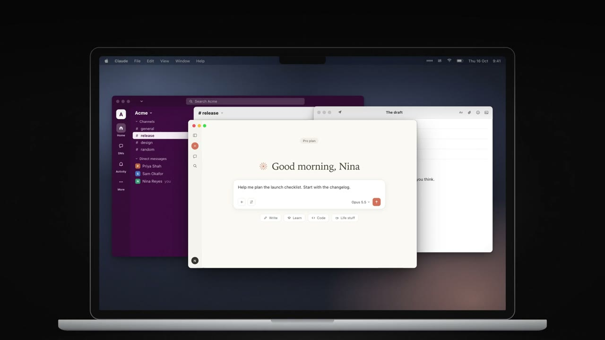
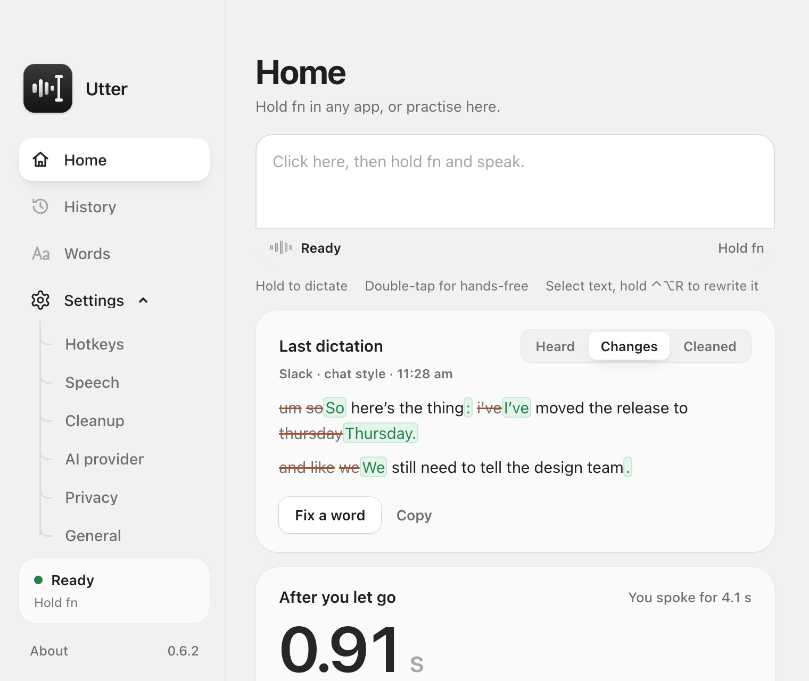
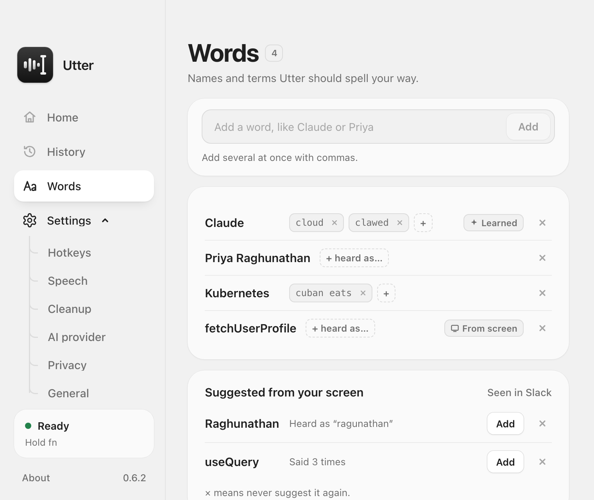
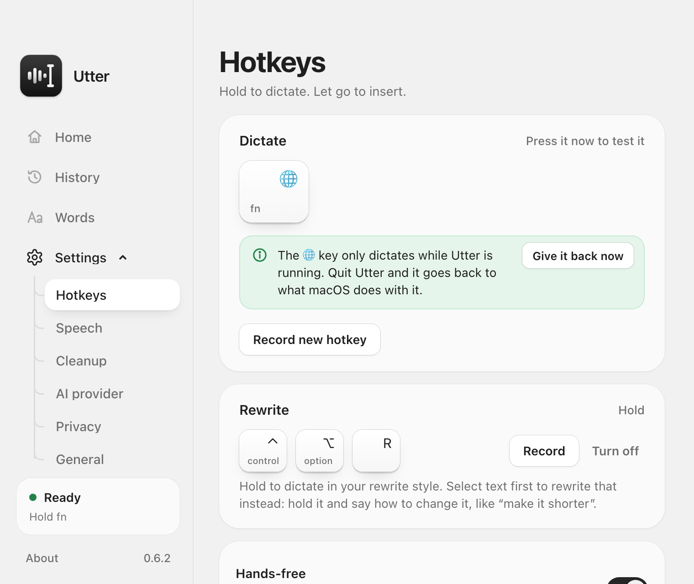
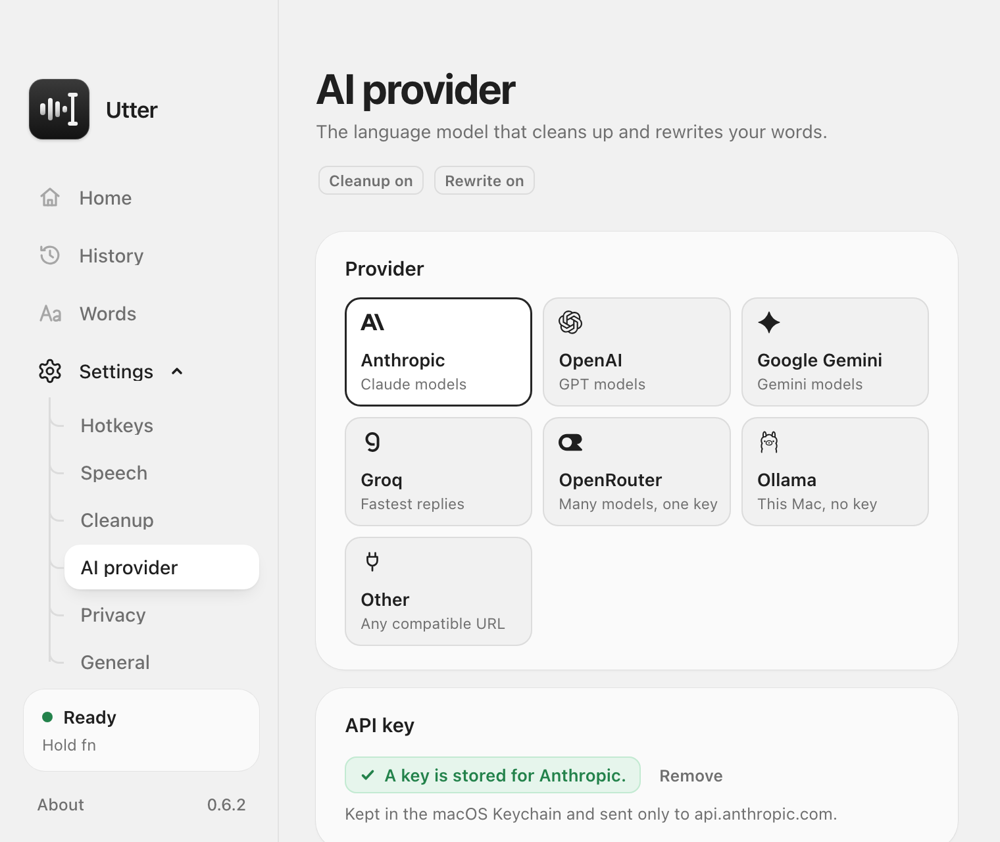
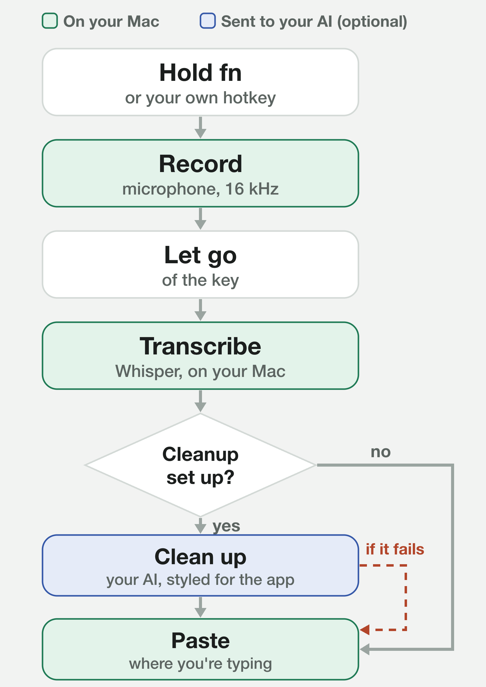

# Utter

**Free, private voice dictation for your Mac.** Hold a key, talk, let go, and
clean, well-formatted text appears in whatever app you are typing in. Your
voice never leaves your Mac.

```sh
brew install --cask shantirmizi/tap/utter
```

Or [download the DMG](https://github.com/ShanTirmizi/utter/releases/latest/download/Utter-apple-silicon.dmg)
(beta, Apple Silicon, macOS 12+) · [Website](https://utter.shantirmizi.com) ·
[Report a problem](https://github.com/ShanTirmizi/utter/issues/new/choose)

<p align="center">
  <a href="https://utter.shantirmizi.com/#film"></a>
</p>

<p align="center">
  
</p>

Why another dictation app:

- **Free for good.** MIT licensed. No subscription, no account, no analytics.
- **Tiny and native.** A few megabytes, written in Rust and Tauri. No
  Electron.
- **Your speech never leaves your Mac.** Transcription runs on the GPU with
  whisper.cpp, and starts while you are still talking, so even a long
  dictation is transcribed a moment after you let go.
- **Writes for where you are.** It knows the app, and in a browser the site:
  Gmail gets an email, Slack a casual message, Claude or ChatGPT a clear prompt.
- **Your model, or none.** Tidy with Groq, Anthropic, OpenAI, Gemini,
  OpenRouter or a local model through Ollama, with your own key. Or skip it.

<p align="center">
  
  
</p>
<p align="center">
  
  
</p>
<p align="center">
  
  
</p>

Everything it does:

- **Runs on your Mac.** Speech is transcribed locally with
  [whisper.cpp](https://github.com/ggml-org/whisper.cpp). Audio never leaves the machine.
- **Bring your own key, or none.** Add a key from Anthropic, OpenAI, Google,
  Groq, OpenRouter or any OpenAI-compatible service to have a model tidy each
  dictation. A local model through Ollama needs no key at all. Without any of
  these, Utter inserts the raw transcription.
- **Fits the app you are in.** A chat message, an email and a code comment each
  get a different writing style.
- **Tidy or rewrite.** One hotkey keeps your wording and cleans it up. A second
  one rewrites what you said so it reads better, in a style you choose.
- **Edit by voice.** Select some text, hold the rewrite hotkey and say what to
  change: "make this shorter", "turn this into bullet points".
- **One key.** Hold the fn (globe) key to talk, double-tap it for
  hands-free. Or pick any key combination you like.
- **Hands-free.** Double-tap the hotkey instead of holding it, talk for up to
  five minutes, and tap once more to finish.
- **Your words.** A personal dictionary for the names and jargon that speech
  recognition gets wrong.
- **History.** Your recent dictations, kept on your Mac only, to search and
  copy again, with how many of them you had to change.

Inspired by voice dictation tools. MIT licensed.

## How it works

<picture>
  <source media="(prefers-color-scheme: dark)" srcset="docs/images/how-it-works-dark.png" />
  
</picture>

1. **Hotkey.** The fn key on its own (or a key combination such as
   `⌃ ⌥ Space`) to dictate, `⌃ ⌥ R` to dictate and rewrite. Change either in
   settings.
2. **Record.** Utter listens only while you are dictating. A double tap
   instead of a hold starts a hands-free recording that runs until the next tap.
3. **Transcribe.** A Whisper model runs on your Mac, using the GPU through
   Metal. It starts while you are still talking: each finished stretch of
   speech is transcribed at the next pause (and, in the **Quick** way, tidied
   too), so when you let go only the last few seconds are left.
4. **Clean up (optional).** The transcript goes to the model you chose, with a
   prompt that removes filler words, fixes punctuation, splits a long dictation
   into short paragraphs, and matches the app you are typing in. **Accurate**
   (the default) tidies the whole dictation once you let go, so a pause in the
   middle of a sentence never splits it; **Quick**, under Cleanup, tidies each
   stretch while you are still talking, so only the last one waits. With the rewrite hotkey, the prompt asks for better wording
   instead, or, if you have text selected, for that text changed the way you
   said. If this step fails for any reason, the raw transcript is used (and
   selected text is left alone).
5. **Insert.** Utter puts the text on the clipboard, presses `⌘V`, and then puts
   your previous clipboard back.

## Install

### Homebrew

```sh
brew install --cask shantirmizi/tap/utter
```

### Download

Get the app from **<https://utter.shantirmizi.com>**, or straight from the
[latest release](https://github.com/ShanTirmizi/utter/releases). It is a beta
for Apple Silicon Macs (M1 or later) on macOS 12 or later.

1. Open the DMG and drag Utter into Applications.
2. Open Utter. Releases are signed with a Developer ID and notarised by Apple,
   so it opens like any other app.
3. Follow the welcome screens.

### Updating

When a new version is out, **About** says so (press **Check for updates**, or
switch on **Check automatically**). Press **Install and restart**: Utter
downloads it, checks its signature, swaps itself for the new version and opens
again, keeping your settings and words. This works however you installed it.
Homebrew users can still run `brew upgrade --cask shantirmizi/tap/utter`.
Versions before 0.6.2 can't do this yet: download the new one once by hand,
and from then on it updates itself.

### Build it yourself

The first build takes several minutes, nearly all of it compiling.

### You need

- macOS 12 or later. Built and tested on Apple Silicon; Intel is untested.
- Xcode Command Line Tools: `xcode-select --install`
- [Rust](https://rustup.rs)
- Node.js 20 or later, with pnpm (`corepack enable`)
- CMake: `brew install cmake`

### Build

```bash
git clone https://github.com/ShanTirmizi/utter.git
cd utter
pnpm install
pnpm tauri build
```

The app is written to `src-tauri/target/release/bundle/macos/Utter.app`. Drag it
into `/Applications` and open it.

### Signing, and why it matters

macOS ties the Microphone and Accessibility permissions to the app's signature,
and Gatekeeper checks downloads for Apple's notarisation.

- **Releases** are signed with a Developer ID and notarised by Apple, so they
  open without warnings and permissions survive updates.
- **Your own build** is signed ad hoc. It is never quarantined, so it opens
  straight away, but each rebuild counts as a new app: allow the microphone
  again and use **Reset it** under General for Accessibility. Set
  `APPLE_SIGNING_IDENTITY` to a signing certificate of your own to avoid that.
- **Maintainers** make a release with `scripts/release.sh`, which signs, packages
  and notarises; see the comments at its top.

## First run

Utter opens with a four-step welcome that takes about a minute:

1. **Hello.** Pressing "Get started" also starts downloading the Small speech
   model (488 MB), so it is usually ready by step 3.
2. **Permissions.** Allow the microphone, and Accessibility, which lets Utter
   type for you and hear the fn key (see below).
3. **Speech model.** Keep Small, or pick another. Base is fastest but
   mishears names and jargon more often. Large is the most accurate and understands
   languages other than English; under **Speech** you can tell it which
   one you speak, or leave it to detect.
4. **Try it.** Hold `fn`, say a sentence, and let go. If you skipped
   Accessibility, this step offers `⌃ ⌥ Space` instead, which works without it.

After that, the window has a sidebar: Home, History and Words, then a
Settings group you can fold away (Hotkeys, Speech, Cleanup, AI provider,
Privacy, General), and About at the foot. The status card above About always
says whether Utter is ready; if it is not, it names the one problem, the
section that fixes it carries a `!` (and shows even with Settings folded), and
clicking the card opens it. The window follows the system appearance, or pick
Light or Dark under **General**, which is also where Utter can open at login
and record from a microphone other than the system default.

Closing the window keeps Utter running in the menu bar. The menu bar icon
moves while Utter listens or works and shows a dot when it needs you. Its menu
starts with the same status, then Open Utter, Copy Last Dictation, Fix Last
Word…, Add a Word…, Undo Learning, About Utter, Check for Updates… and Quit Utter.

## Set up cleanup (optional)

1. Under **AI provider**, pick a provider.
2. Paste an API key for it and press Save. The **Get a … key** link (for
   example "Get an Anthropic key") opens the provider's key page.
3. Choose a model. Click the model field to pick from what your key can use
   (**List models** refreshes the list), or type a name. Pick a small, fast
   one: cleanup is light editing, and you wait for it.
4. Press **Test** to confirm it works.

| Provider | Key | Model |
| --- | --- | --- |
| Anthropic (Claude) | Yes | Defaults to Claude Haiku |
| OpenAI, Google Gemini, Groq, OpenRouter | Yes | You choose |
| Ollama | No, runs on your Mac | You choose from the models you have pulled |
| Other (OpenAI-compatible) | Yes | You enter the base URL and choose |

Keys are stored in the macOS Keychain and nowhere else, one per provider. They
are not written to any file, not logged, and never shown again in the app. A
key is sent only to the provider it belongs to. With a small model, a typical
dictation costs a fraction of a cent.

To dictate without cleanup, switch **Cleanup** off on the Cleanup page, or
simply do not add a key.

## Rewrite (optional)

Tidying keeps your words. Sometimes you want the opposite: say it roughly, and
have it written well. Hold the rewrite hotkey (`⌃ ⌥ R`) instead of the
dictation hotkey and Utter rewrites what you said before inserting it.

- **Styles.** Clearer, Shorter, Professional or Friendly, or "Your own": an
  instruction you write yourself, such as "Reply as a short, upbeat message" or
  "Translate into French".
- **What it keeps.** With the built-in styles, every point, name and number you
  said, and nothing you did not say. Your own instruction can ask for anything.
- **How it looks.** Short paragraphs instead of one block, and a list where you
  named several items. A short message stays short. It is written for where it
  is going: an email gets a greeting on its own line if you said one, a chat
  message stays casual, a prompt for Claude or ChatGPT gets its details as a
  list. No em dashes, anywhere.
- **What it needs.** A cleanup model, set up as above. It works even when
  **Cleanup** is switched off, since pressing the rewrite hotkey is
  an explicit request.
- **If it goes wrong.** You get your raw words and a note saying why. The
  menu-bar icon can copy the last dictation again.

Pick the style under **Cleanup**, and press **Test on a sample** to see what it
does to a sentence. The rewrite hotkey itself is under **Hotkeys**; turn it off
there to switch the feature off.

## Edit selected text

Select text in any app, hold the rewrite hotkey (`⌃ ⌥ R`) and say what you
want done to it: "make this more formal", "fix the grammar", "translate this to
Spanish". Utter replaces the selection with the result.

- With nothing selected, the same hotkey rewrites what you say, as above.
- It needs Accessibility (to see the selection and to paste) and a cleanup
  model.
- If anything goes wrong, your selected text is not touched and the pill says
  why.
- In code editors Utter only edits a selection it can read directly, because
  there the usual fallback (copying) would grab the whole line when nothing is
  selected.

## Hands-free

Double-tap the hotkey (two quick presses) and Utter keeps listening. Tap
either hotkey once more to finish; the text goes in as usual. A single quick
tap does nothing but remind you how to start.

- The pill shows "tap to finish" while it runs.
- If you walk away, it stops by itself after 30 seconds without a sound, or
  after five minutes at most. What you said is then copied to the clipboard
  rather than typed, so it cannot land in the wrong place.
- Switch it off under **Hotkeys** if you never want it. A double tap is then
  ignored.

## The fn key

Out of the box you dictate with fn (the globe key) on its own:

- **Hold fn** and speak; let go to insert.
- **Double-tap fn** for hands-free; tap once more to finish.
- **fn in a shortcut** (fn+arrow, fn+Delete) still works as usual: the
  moment another key is pressed with fn, Utter drops that recording.

To use a key combination instead, click **Record new hotkey** under
**Hotkeys**. **Reset to fn** brings fn back.

macOS will not register a lone modifier key as a hotkey, so Utter watches for
fn with an event tap. That needs the Accessibility permission (already used for
pasting) and no other. The tap looks only at fn going down and up and at
whether another key is pressed while fn is held; it never looks at which key.

macOS has its own action for the globe key ("Press 🌐 key to" in Keyboard
settings), such as opening the emoji picker, and it runs before any app sees
the key. So, by default, while Utter is using fn it sets that option to Do
Nothing, and puts your own choice back when you quit, pick another hotkey, or
click **Give it back now** under **Hotkeys** (which turns this off; **Turn it
off while Utter runs** turns it on again). Your original choice is saved first, so it comes back even after a
crash, at the next launch. Or change it yourself in Keyboard settings.

## Your words

The **Words** tab holds the names, products and terms that are often
misheard, spelled the way you want them. Utter gives the list to the speech
model as a hint and to the cleanup model as the correct spellings. Up to 200
entries; a handful of the ones you actually say works best.

- **Heard as.** Tell a word what Utter writes by mistake: Claude, heard as
  "cloud". Cleanup then puts that right when the sentence is about your word
  ("ask cloud to summarise this") and leaves it alone when it is not ("the
  cloud bill went up"). In the **Quick** way, a dictation that may hold one of your words misheard,
  taught or simply sounding alike, always goes to the cleanup model, even
  when it is short and already looks clean (in **Accurate**, the default,
  every dictation does). This needs cleanup set up; raw
  text only gets the speech model's hint.
- **Fix a word.** On **Home** or **History**, press **Fix** on a dictation and click the
  word that came out wrong. It is corrected there, and the right spelling and
  the mishearing are remembered. Click the next word too when one name was
  heard as two ("pre a" for Priya).
- **Learning.** Change a word Utter just typed into the name it misheard
  ("cloud" to Claude) and Utter adds it, with the mishearing, and says so in
  the pill. **Undo Learning** in the menu bar, or Undo on the Words tab, takes
  it back for good. Utter reads only the text box it pasted into, for at most
  a minute after the paste, and keeps nothing but the word and a count of the
  words you changed (see History). Typo fixes,
  rewording, deletions and everyday words are ignored. Apps that do not expose
  their text (Google Docs, terminals) cannot be learned from; use Fix instead.
  Switch it off on the Words tab.
- **Names on screen.** When you start dictating, Utter reads the names in the
  window in front (people in a Slack thread, functions in your editor) and
  uses them as hints for that one dictation, so they are spelled the way the
  screen spells them. A dictation that continues a sentence starts in lower
  case with a space, from what is just before the cursor. With **Send nearby
  text to cleanup** also on (off unless you turn it on), cleanup is shown a
  short excerpt of the text around the cursor (the conversation above a chat
  box, say), so a misheard word can be put right from it; never from a
  terminal or code editor. None of the window's text is ever kept. A name you then say
  is offered under **Suggested from your screen**; nothing is added without
  you. Switch it off under **Privacy**.
- **Add a Word…** in the menu bar opens the list ready to type into.
- A word you remove is never learned or suggested again, and stays under
  **Removed recently** for 30 days with its mishearings, in case you want it
  back.

## History

The **History** tab lists your recent dictations. Search them, copy one
again, fix a word, forget one, or clear them all.

- Kept in one file on your Mac (`history.json` in Utter's Application Support
  folder), readable only by your user account. Never sent anywhere.
- The most recent 200 are kept.
- Switch **Keep history** off (under **Privacy**) and nothing new is saved.
- **Edits.** A dictation you changed after Utter pasted it says how many words
  you changed, and **History** shows the share you left as typed: the number
  that says how well Utter is doing for you. Utter can tell only while it
  follows the text box after a paste (with **Learn from my corrections** or
  **Keep recordings** on, and Accessibility allowed); fixing a word on
  **Home** or **History** counts too. Only the count is kept.
- **Keep recordings** (under **Privacy**, off by default) also keeps the audio of
  your last 50 dictations, as 16 kHz WAV files in a `recordings` folder next
  to `history.json`, readable only by your user account, with the text as you
  corrected it. They are for trying other speech models and prompts on what
  you really said (see "Measuring accuracy" under Development). A recording
  is deleted with its dictation, when it is older than the last 50, or all at
  once when you switch the setting off. They are never uploaded.

## Permissions

| Permission | Needed | Why |
| --- | --- | --- |
| Microphone | Yes | To hear you while the hotkey is held. |
| Accessibility | Recommended | To hear the fn key, to press `⌘V` in the app you are typing in, to see the text you selected when you edit by voice, to read names in the window in front while you dictate, and to notice a word you correct right after a paste. Without it, Utter copies the text and you paste it yourself, and you dictate with a key combination instead of fn. |
| Input Monitoring | No | With the fn key, Utter notices only that some other key was pressed while fn is held, never which (see "The fn key"). A key combination is registered with macOS as a system hotkey, so Utter never sees your other keystrokes. |

You can change these under System Settings > Privacy & Security.

**If Accessibility is switched on but Utter still says it is not allowed:**
macOS is matching the switch to an older build of the app. In Utter, under
**General**, click **Reset it**, then switch Utter on again in System
Settings. This happens after every rebuild of an ad-hoc signed build, for the
reason given under "Signing, and why it matters".

## What leaves your Mac

The **Privacy** page in Utter sums this up for your own settings.

- **Audio:** never. Recordings kept with **Keep recordings** stay in a folder
  on your Mac.
- **Text:** only when cleanup is set up. Then the transcript, the name of the
  app (or, in a browser, the site), your word list and any names read from
  the window in front are sent to the provider you chose. With **Send nearby
  text to cleanup** on (it is off unless you turn it on), so is a short
  excerpt of the text around the cursor (about 1,500 characters near the box
  you are typing in, and what is before the cursor), to correct misheard
  words. It is never sent from a terminal or code editor, anything that
  looks like a key or token is left out, and it is never saved. When you
  edit selected text, that text is sent too. With Ollama, all of it stays on
  your Mac.
- **History:** never. It is a file on your Mac, as are the edit counts.
- **Speech models:** downloaded once from Hugging Face, on request. The
  first one brings a small (under 1 MB) voice activity model that tells
  speech from noise; if you had a speech model before it existed, it is
  fetched once, from the same place, the next time Utter starts.
- **Update check:** only when you press **Check for updates** in About, or
  once a day if you switch on **Check automatically** (off by default). It is
  one request to GitHub for the latest release and sends nothing about you.
  An update downloads only when you press **Install and restart**, straight
  from the GitHub release, and is installed only if its signature matches the
  key built into your copy of Utter.
- Utter has no account, no analytics and no telemetry.

## Speed

Most of the wait after you let go used to be the language model. Utter now:

- **Works while you talk.** At each clear pause, the speech so far is
  transcribed. When you let go, only the last stretch is left. With **Quick**
  under Cleanup, each stretch is tidied as you go too; **Accurate**, the
  default, tidies the whole dictation once you let go, so the model sees every
  sentence whole.
- **Skips the model when there is nothing to fix (Quick only).** A short
  dictation the speech model already wrote cleanly (no ums, repeats or "no
  wait") goes in as it is.
- **Keeps a local model loaded.** Ollama unloads a model after five minutes
  idle, and loading a 4B model back takes seconds. Utter asks it to keep the
  model for an hour.

How fast the rest is depends on the model. A small model on your Mac writes
about 30 words a second, so a long reply still takes a few seconds when it
has to be done at the end. A hosted model such as Groq's is many times
faster.

## Long dictations

Whatever you dictate, a long message never goes in as one giant paragraph. The
model is asked for short paragraphs, a new one for each new point. If it
returns one long block anyway, or there is no model and the text is the raw
transcription, Utter splits it into paragraphs of a few sentences itself,
breaking where a sentence moves on ("So", "Also", "Oh, and"). Code editors and
terminals are left alone.

## Limits in this version

- macOS only.
- In a browser, Utter recognises common sites (Gmail, Outlook, Slack, Discord,
  WhatsApp, Teams, Claude, ChatGPT, Gemini, Notion, Google Docs and a few
  more) from the address of the page you are typing in. It reads the address
  through Accessibility, on your Mac, and sends only the site's name. Other
  sites get the neutral style.
- Small local models follow the layout rules less reliably than hosted ones:
  a prompt for an AI assistant may stay one paragraph.
- With a Bluetooth microphone the first word can be clipped if you speak the
  instant you press the key. Utter keeps other microphones ready between
  dictations (without listening), but leaves Bluetooth ones alone so your
  headphones stay in high-quality mode.
- Reading the selection does not work in every app. Where it cannot be read,
  the rewrite hotkey rewrites what you said instead.
- Pasting does not work in fields that block `⌘V`.
- If the pill ever stays on "Listening" after you let go, tap the same hotkey
  once to end it. A held recording that is never released is closed and
  discarded after five minutes.
- While one dictation is still being transcribed or tidied, pressing the hotkey
  again does nothing; the pill keeps showing the work under way.
- Small local models make mistakes when tidying and rewriting: they can miss a
  self-correction or drop a detail. Utter checks that a reply is a version of
  what you said and falls back to your raw words if not, but it cannot catch
  every slip. A hosted model is faster and more accurate.

## Development

```bash
pnpm tauri dev                 # run the app with live reload
pnpm dev                       # the UI only, in a browser, with a pretend backend
cd src-tauri && cargo test     # unit tests
cargo run --example transcribe -- model.bin audio.wav   # transcribe a file
cargo run --release --example replay                    # score models on your recordings
```

### Measuring accuracy

With **Keep recordings** on, every dictation leaves a WAV file and, once you
have finished with the pasted text, what you made of it. The replay example
runs those recordings through any speech model and any cleanup model, and
scores each combination:

```bash
cd src-tauri
cargo run --release --example replay -- --model base.en --model large-v3-turbo-q5_0 --cleanup none --cleanup saved
```

Each recording is compared with, in order: a reference you wrote by hand, the
text as you corrected it, or the text as pasted if you left it alone (which
favours the settings that wrote it). For hand-written references, put a
`labels.tsv` next to the recordings: one line per file, the file name, a tab,
and exactly what you said. `--dir` takes any folder of WAV files instead, so a
fixed test set works too. `--cleanup` is `none`, `saved` (the provider and
model set in the app) or `provider/model`; the key comes from `UTTER_API_KEY`
or the app's Keychain entry. `--each` prints every recording.

For each combination it prints the word error rate (case and punctuation
ignored), the words you would still have to change per dictation (exactly as
typed), the share that would need no change, and the time taken. Only the
cleanup model you pick is sent anything, as in the app.

To test the whole pipeline without speaking, a debug build can take recordings
from disk and process them as if dictated. Results are printed and left on the
clipboard; nothing is pasted and nothing is added to the history. Add
`@rewrite` to a path to use rewrite mode, or `@edit` to treat the words as an
instruction for the text in `UTTER_SIMULATE_SELECTION`.

```bash
ffmpeg -i clip.wav -ar 16000 -ac 1 -f f32le clip.f32
UTTER_SIMULATE=clip.f32,clip.f32@rewrite pnpm tauri dev
UTTER_SIMULATE=instruction.f32@edit UTTER_SIMULATE_SELECTION="Text to change." pnpm tauri dev
```

When run with `pnpm tauri dev`, macOS attributes the permission prompts to your
terminal app rather than to Utter.

The code is laid out as one file per stage of the pipeline, in
`src-tauri/src`:

| File | Job |
| --- | --- |
| `lib.rs` | App setup, the commands the window calls, windows and appearance |
| `hotkey.rs` | Register the two push-to-talk hotkeys |
| `fnkey.rs`, `globe.rs` | The fn key on its own, and switching off macOS's globe-key action while it is used |
| `audio.rs` | Record the microphone, convert to 16 kHz mono, filter out rumble |
| `transcribe.rs`, `models.rs` | Run whisper.cpp, download models |
| `parakeet.rs` | The Parakeet engine, through a small Swift helper (in the code, not yet bundled in releases) |
| `tech.rs` | Well-known tech names and how speech models mishear them |
| `speech.rs` | Tell speech from silence and noise, so none of it becomes text |
| `context.rs` | Work out which app is focused and what kind it is |
| `cleanup.rs` | The tidy and rewrite prompts, the two API formats, reply checks |
| `providers.rs` | The list of cleanup providers |
| `selection.rs` | Read the text selected in the focused app |
| `insert.rs` | Clipboard save, paste, restore |
| `pipeline.rs` | Runs the stages in order |
| `history.rs`, `recordings.rs` | Past dictations, in a file on this Mac, and their recordings when kept |
| `accuracy.rs`, `replay.rs` | What the user changed after a paste, scoring, and what the replay example needs |
| `words.rs`, `learn.rs`, `screen.rs` | Your words and their mishearings, learning from corrections, names on screen |
| `tray.rs`, `updates.rs` | The menu bar icon and menu, checking for and installing updates |
| `secrets.rs`, `settings.rs` | Keychain and preferences |
| `permissions.rs` | Check and request macOS permissions |
| `login.rs` | Open at login |

The download page lives in `site/` (plain HTML, CSS and a little JavaScript)
and is deployed to Vercel.

The interface is React and hand-written CSS, in `src`:

| File | Job |
| --- | --- |
| `main.tsx` | Starts the window, or the pill, and sets light or dark |
| `api.ts` | Typed wrappers around the Rust commands and events |
| `state.tsx`, `readiness.ts` | What the window knows, and whether Utter is ready |
| `App.tsx` | The sidebar, status card, and the first-run switch |
| `Welcome.tsx` | The first-run flow |
| `sections/` | One file per section |
| `Pill.tsx` | The status pill |
| `ui.tsx` | Icons, keycaps, switches and other small parts |
| `hotkey.ts`, `diff.ts`, `providerMarks.tsx` | Hotkey labels, the word diff in Changes, provider logos |
| `styles/` | `quiet.css` (tokens for light and dark, and components) and `app.css` |
| `dev-mock.ts` | The pretend backend for `pnpm dev` |

With `pnpm dev`, open `http://localhost:1420` and hold `⌃ ⌥ Space` (standing
in for fn, which a browser cannot see) to play a dictation. `/#pill` shows the status pill and `?welcome` the first run; the
notes at the top of `dev-mock.ts` list the other switches.

More on the design choices is in [docs/DESIGN.md](docs/DESIGN.md).

## Contributing

Bug reports and ideas are welcome through the
[issue forms](https://github.com/ShanTirmizi/utter/issues/new/choose). For code,
see [CONTRIBUTING.md](CONTRIBUTING.md); for security problems,
[SECURITY.md](SECURITY.md).

## Licence

[MIT](LICENSE)

The app and the download page use the system font; no typefaces are bundled.
The launch film's footage, music, sound effects and voice were generated with
ElevenLabs; its app scenes are drawn from the real interfaces of Utter, Slack, Mail and Claude.
The provider marks come from [@lobehub/icons-static-svg](https://github.com/lobehub/lobe-icons)
(MIT) and are shown in one colour; they are trademarks of their owners.
