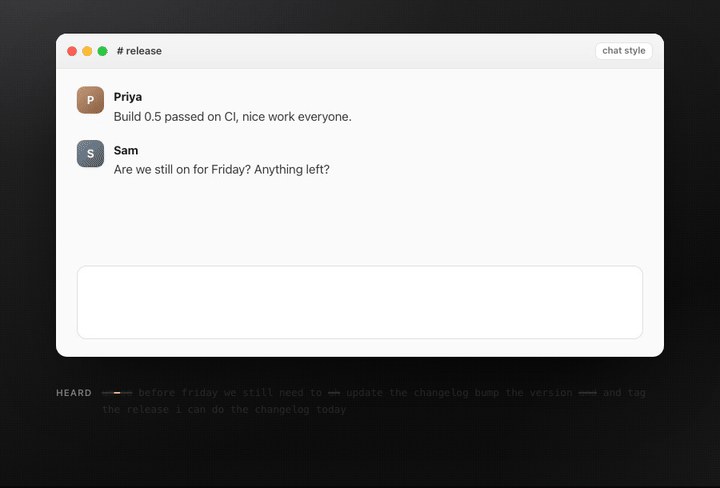
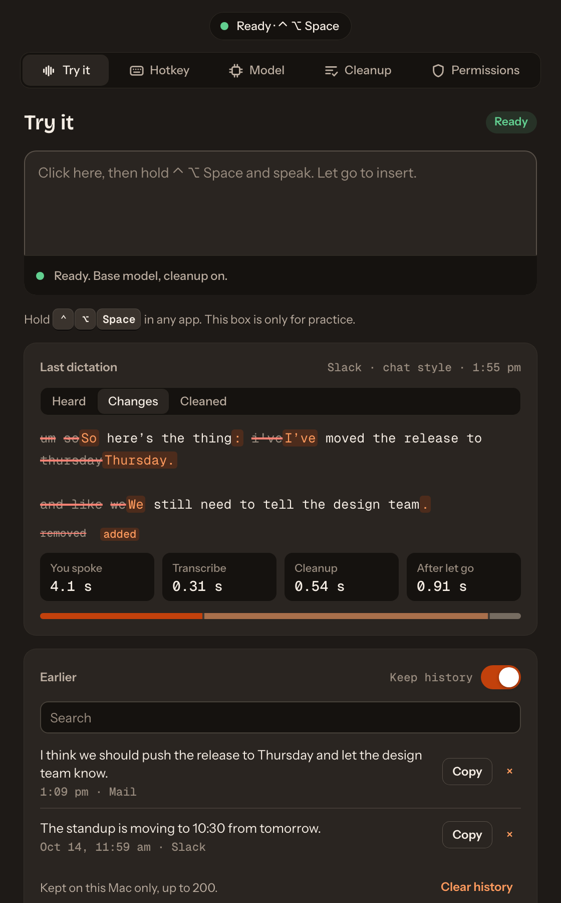
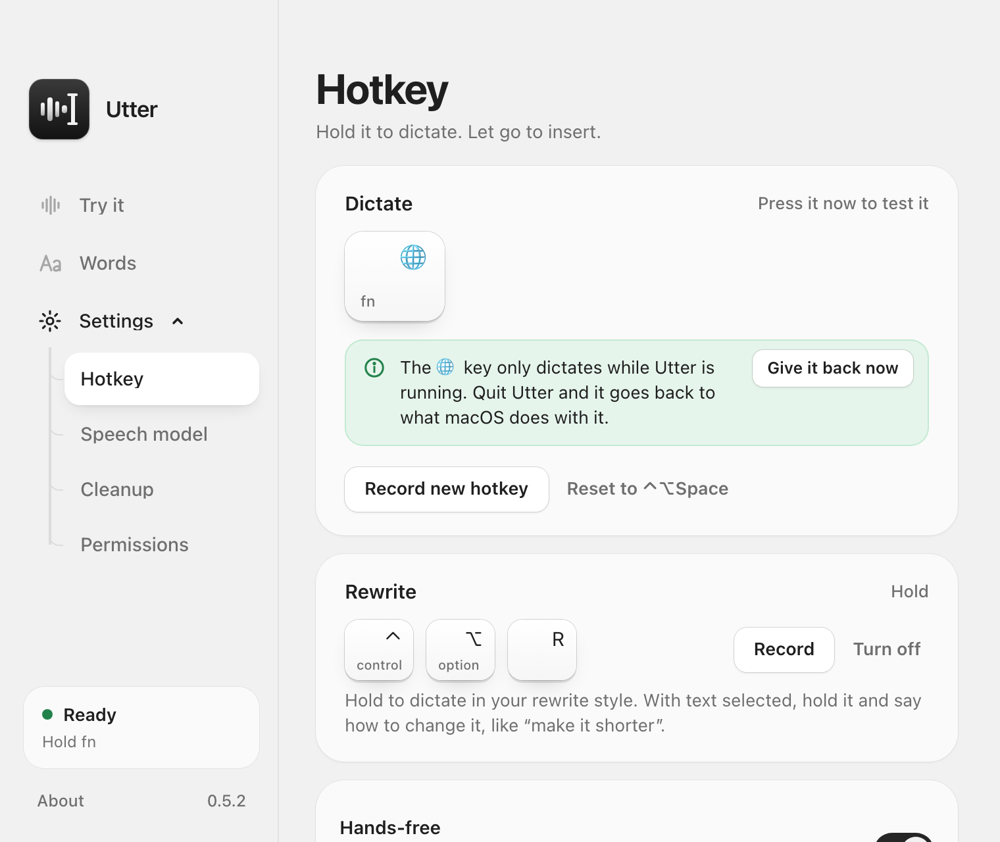
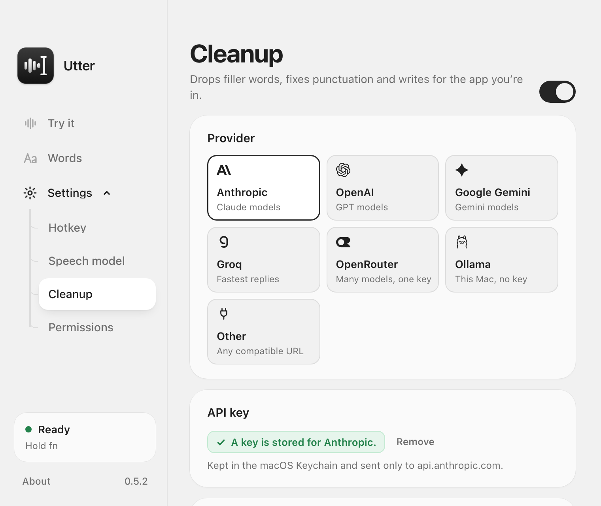
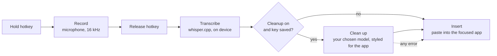

# Utter

**Free, open-source voice dictation for macOS.** Hold a key, speak, let go, and
clean, well-formatted text appears in whatever app you are typing in.

**Beta.** [Download for Mac](https://github.com/ShanTirmizi/utter/releases/latest/download/Utter-apple-silicon.dmg)
(Apple Silicon, macOS 12+) · [Website](https://utter-beta.vercel.app) ·
[Report a problem](https://github.com/ShanTirmizi/utter/issues/new/choose)

<p align="center">
  
</p>

Why another dictation app:

- **Tiny and native.** A 4.5 MB download, written in Rust and Tauri. No
  Electron, no account, no analytics.
- **Your speech never leaves your Mac.** Transcription runs on the GPU with
  whisper.cpp, and starts while you are still talking, so long dictations go
  in a moment after you let go.
- **Writes for where you are.** It knows the app, and in a browser the site:
  Gmail gets an email, Slack a casual message, Claude or ChatGPT a clear prompt.
- **Your model, or none.** Tidy with Groq, Anthropic, OpenAI, Gemini,
  OpenRouter or a local model through Ollama, with your own key. Or skip it.

<p align="center">
  
  
  
</p>
<p align="center">
  
  
</p>

Everything it does:

- **Runs on your Mac.** Speech is transcribed locally with
  [whisper.cpp](https://github.com/ggml-org/whisper.cpp). Audio never leaves the machine.
- **Bring your own key, or none.** Add a key from Anthropic, OpenAI, Google,
  Groq, OpenRouter or any OpenAI-compatible service to have a model tidy each
  dictation. A local model through Ollama needs no key at all. Without any of
  these, Utter inserts the raw transcription.
- **Fits the app you are in.** A chat message, an email and a code comment each
  get a different writing style.
- **Tidy or rewrite.** One hotkey keeps your wording and cleans it up. A second
  one rewrites what you said so it reads better, in a style you choose.
- **Edit by voice.** Select some text, hold the rewrite hotkey and say what to
  change: "make this shorter", "turn this into bullet points".
- **One key if you like.** Use the fn (globe) key on its own: hold it to
  talk, double-tap it for hands-free.
- **Hands-free.** Double-tap the hotkey instead of holding it, talk for up to
  five minutes, and tap once more to finish.
- **Your words.** A personal dictionary for the names and jargon that speech
  recognition gets wrong.
- **History.** Your recent dictations, kept on your Mac only, to search and
  copy again.

Inspired by voice dictation tools. MIT licensed.

## How it works



1. **Hotkey.** `⌃ ⌥ Space` (or the fn key on its own) to dictate, `⌃ ⌥ R` to
   dictate and rewrite. Change either in settings.
2. **Record.** Utter listens only while you are dictating. A double tap
   instead of a hold starts a hands-free recording that runs until the next tap.
3. **Transcribe.** A Whisper model runs on your Mac, using the GPU through
   Metal. It starts while you are still talking: each finished stretch of
   speech is transcribed (and tidied) at the next pause, so when you let go
   only the last few seconds are left.
4. **Clean up (optional).** The transcript goes to the model you chose, with a
   prompt that removes filler words, fixes punctuation, splits a long dictation
   into short paragraphs, and matches the app you are typing in. With the rewrite hotkey, the prompt asks for better wording
   instead, or, if you have text selected, for that text changed the way you
   said. If this step fails for any reason, the raw transcript is used (and
   selected text is left alone).
5. **Insert.** Utter puts the text on the clipboard, presses `⌘V`, and then puts
   your previous clipboard back.

## Install

### Download

Get the app from **<https://utter-beta.vercel.app>**, or straight from the
[latest release](https://github.com/ShanTirmizi/utter/releases). It is a beta
for Apple Silicon Macs (M1 or later) on macOS 12 or later.

1. Open the DMG and drag Utter into Applications.
2. Open Utter. Releases are signed with a Developer ID and notarised by Apple,
   so it opens like any other app.
3. Follow the welcome screens.

### Build it yourself

The first build takes several minutes, nearly all of it compiling.

### You need

- macOS 12 or later. Built and tested on Apple Silicon; Intel is untested.
- Xcode Command Line Tools: `xcode-select --install`
- [Rust](https://rustup.rs)
- Node.js 20 or later, with pnpm (`corepack enable`)
- CMake: `brew install cmake`

### Build

```bash
git clone https://github.com/ShanTirmizi/utter.git
cd utter
pnpm install
pnpm tauri build
```

The app is written to `src-tauri/target/release/bundle/macos/Utter.app`. Drag it
into `/Applications` and open it.

### Signing, and why it matters

macOS ties the Microphone and Accessibility permissions to the app's signature,
and Gatekeeper checks downloads for Apple's notarisation.

- **Releases** are signed with a Developer ID and notarised by Apple, so they
  open without warnings and permissions survive updates.
- **Your own build** is signed ad hoc. It is never quarantined, so it opens
  straight away, but each rebuild counts as a new app: allow the microphone
  again and use **Reset it** under Permissions for Accessibility. Set
  `APPLE_SIGNING_IDENTITY` to a signing certificate of your own to avoid that.
- **Maintainers** make a release with `scripts/release.sh`, which signs, packages
  and notarises; see the comments at its top.

## First run

Utter opens with a four-step welcome that takes about a minute:

1. **Hello.** Pressing "Get started" also starts downloading the Base speech
   model (148 MB), so it is usually ready by step 3.
2. **Permissions.** Allow the microphone; Accessibility is optional (see below).
3. **Speech model.** Keep Base, or pick a larger one.
4. **Try it.** Hold `⌃ ⌥ Space`, say a sentence, and let go.

After that, the window has five tabs: Try it, Hotkey, Model, Cleanup and
Permissions. The capsule in the title bar always says whether Utter is ready,
and if it is not, clicking it opens the tab that fixes it.

Closing the window keeps Utter running in the menu bar. Quit from the menu-bar
icon.

## Set up cleanup (optional)

1. Under **Cleanup**, pick a provider.
2. Paste an API key for it and press Save. The "Get a key" link opens the
   provider's key page.
3. Choose a model. **List models** shows what your key can use. Pick a small,
   fast one: cleanup is light editing, and you wait for it.
4. Press **Test** to confirm it works.

| Provider | Key | Model |
| --- | --- | --- |
| Anthropic (Claude) | Yes | Defaults to Claude Haiku |
| OpenAI, Google Gemini, Groq, OpenRouter | Yes | You choose |
| Ollama | No, runs on your Mac | You choose from the models you have pulled |
| Other (OpenAI-compatible) | Yes | You enter the base URL and choose |

Keys are stored in the macOS Keychain and nowhere else, one per provider. They
are not written to any file, not logged, and never shown again in the app. A
key is sent only to the provider it belongs to. With a small model, a typical
dictation costs a fraction of a cent.

To dictate without cleanup, switch off **Clean up dictations** or simply do not
add a key.

## Rewrite (optional)

Tidying keeps your words. Sometimes you want the opposite: say it roughly, and
have it written well. Hold the rewrite hotkey (`⌃ ⌥ R`) instead of the
dictation hotkey and Utter rewrites what you said before inserting it.

- **Styles.** Clearer, Shorter, Professional or Friendly, or "Your own": an
  instruction you write yourself, such as "Reply as a short, upbeat message" or
  "Translate into French".
- **What it keeps.** With the built-in styles, every point, name and number you
  said, and nothing you did not say. Your own instruction can ask for anything.
- **How it looks.** Short paragraphs instead of one block, and a list where you
  named several items. A short message stays short. It is written for where it
  is going: an email gets a greeting on its own line if you said one, a chat
  message stays casual, a prompt for Claude or ChatGPT gets its details as a
  list. No em dashes, anywhere.
- **What it needs.** A cleanup model, set up as above. It works even when
  "Clean up dictations" is switched off, since pressing the rewrite hotkey is
  an explicit request.
- **If it goes wrong.** You get your raw words and a note saying why. The
  menu-bar icon can copy the last dictation again.

Pick the style under **Cleanup**, and press **Test on a sample** to see what it
does to a sentence. The rewrite hotkey itself is under **Hotkey**; turn it off
there to switch the feature off.

## Edit selected text

Select text in any app, hold the rewrite hotkey (`⌃ ⌥ R`) and say what you
want done to it: "make this more formal", "fix the grammar", "translate this to
Spanish". Utter replaces the selection with the result.

- With nothing selected, the same hotkey rewrites what you say, as above.
- It needs Accessibility (to see the selection and to paste) and a cleanup
  model.
- If anything goes wrong, your selected text is not touched and the pill says
  why.
- In code editors Utter only edits a selection it can read directly, because
  there the usual fallback (copying) would grab the whole line when nothing is
  selected.

## Hands-free

Double-tap the hotkey (two quick presses) and Utter keeps listening. Tap
either hotkey once more to finish; the text goes in as usual. A single quick
tap does nothing but remind you how to start.

- The pill shows "tap to finish" while it runs.
- If you walk away, it stops by itself after 30 seconds without a sound, or
  after five minutes at most. What you said is then copied to the clipboard
  rather than typed, so it cannot land in the wrong place.
- Switch it off under **Hotkey** if you never want it. A double tap is then
  ignored.

## The fn key

Under **Hotkey**, click **Use the fn key** to dictate with fn (the globe key)
on its own, like this:

- **Hold fn** and speak; let go to insert.
- **Double-tap fn** for hands-free; tap once more to finish.
- **fn in a shortcut** (fn+arrow, fn+Delete) still works as usual: the
  moment another key is pressed with fn, Utter drops that recording.

macOS will not register a lone modifier key as a hotkey, so Utter watches for
fn with an event tap. That needs the Accessibility permission (already used for
pasting) and no other. The tap looks only at fn going down and up and at
whether another key is pressed while fn is held; it never looks at which key.

macOS has its own action for the globe key ("Press 🌐 key to" in Keyboard
settings), such as opening the emoji picker, and it runs before any app sees
the key. So, by default, while Utter is using fn it sets that option to Do
Nothing, and puts your own choice back when you quit, pick another hotkey, or
click **Give it back now** on the Hotkey tab (which turns this off; **Turn it
off while Utter runs** turns it on again). Your original choice is saved first, so it comes back even after a
crash, at the next launch. Or change it yourself in Keyboard settings.

## Your words

The **Words** tab holds the names, products and terms that are often
misheard, spelled the way you want them. Utter gives the list to the speech
model as a hint and to the cleanup model as the correct spellings. Up to 200
entries; a handful of the ones you actually say works best.

- **Heard as.** Tell a word what Utter writes by mistake: Claude, heard as
  "cloud". Cleanup then puts that right when the sentence is about your word
  ("ask cloud to summarise this") and leaves it alone when it is not ("the
  cloud bill went up"). A dictation that may hold one of your words misheard,
  taught or simply sounding alike, always goes to the cleanup model, even
  when it is short and already looks clean. This needs cleanup set up; raw
  text only gets the speech model's hint.
- **Fix a word.** On **Try it**, press **Fix** on a dictation and click the
  word that came out wrong. It is corrected there, and the right spelling and
  the mishearing are remembered. Click the next word too when one name was
  heard as two ("pre a" for Priya).
- **Add a Word…** in the menu bar opens the list ready to type into.
- A word you remove is never learned or suggested again.

## History

The **Try it** tab lists your recent dictations under the last one. Search
them, copy one again, forget one, or clear them all.

- Kept in one file on your Mac (`history.json` in Utter's Application Support
  folder), readable only by your user account. Never sent anywhere.
- The most recent 200 are kept.
- Switch **Keep history** off and nothing new is saved.

## Permissions

| Permission | Needed | Why |
| --- | --- | --- |
| Microphone | Yes | To hear you while the hotkey is held. |
| Accessibility | Recommended | To press `⌘V` in the app you are typing in, and to see the text you selected when you edit by voice. Without it, Utter copies the text and you paste it yourself. |
| Input Monitoring | No | A key combination is registered with macOS as a system hotkey, so Utter never sees your other keystrokes. With the fn key option, Utter notices only that some other key was pressed while fn is held, never which (see "The fn key"). |

You can change these under System Settings > Privacy & Security.

**If Accessibility is switched on but Utter still says it is not allowed:**
macOS is matching the switch to an older build of the app. In Utter, under
**Permissions**, click **Reset it**, then switch Utter on again in System
Settings. This happens after every rebuild of an ad-hoc signed build, for the
reason given under "Signing, and why it matters".

## What leaves your Mac

- **Audio:** never.
- **Text:** only when cleanup is set up. Then the transcript, the name of the
  app (or, in a browser, the site) and your word list are sent to the provider you chose. When you
  edit selected text, that text is sent too. With Ollama, all of it stays on
  your Mac.
- **History:** never. It is a file on your Mac.
- **Speech models:** downloaded once from Hugging Face, on request.
- Utter has no account, no analytics and no telemetry.

## Speed

Most of the wait after you let go used to be the language model. Utter now:

- **Works while you talk.** At each clear pause, the speech so far is
  transcribed and, for the dictation hotkey, tidied. When you let go, only
  the last stretch is left: a 95-second dictation is typed about 0.3 s after
  release in testing on an M1 Pro, against 17 s before.
- **Skips the model when there is nothing to fix.** A short dictation the
  speech model already wrote cleanly (no ums, repeats or "no wait") goes in
  as it is.
- **Keeps a local model loaded.** Ollama unloads a model after five minutes
  idle, and loading a 4B model back takes seconds. Utter asks it to keep the
  model for an hour.

How fast the rest is depends on the model. A small model on your Mac writes
about 30 words a second, so a long reply still takes a few seconds when it
has to be done at the end. A hosted model such as Groq's is many times
faster.

## Long dictations

Whatever you dictate, a long message never goes in as one giant paragraph. The
model is asked for short paragraphs, a new one for each new point. If it
returns one long block anyway, or there is no model and the text is the raw
transcription, Utter splits it into paragraphs of a few sentences itself,
breaking where a sentence moves on ("So", "Also", "Oh, and"). Code editors and
terminals are left alone.

## Limits in this version

- macOS only.
- In a browser, Utter recognises common sites (Gmail, Outlook, Slack, Discord,
  WhatsApp, Teams, Claude, ChatGPT, Gemini, Notion, Google Docs and a few
  more) from the address of the page you are typing in. It reads the address
  through Accessibility, on your Mac, and sends only the site's name. Other
  sites get the neutral style.
- Small local models follow the layout rules less reliably than hosted ones:
  a prompt for an AI assistant may stay one paragraph.
- With a Bluetooth microphone the first word can be clipped if you speak the
  instant you press the key. Utter keeps other microphones ready between
  dictations (without listening), but leaves Bluetooth ones alone so your
  headphones stay in high-quality mode.
- Reading the selection does not work in every app. Where it cannot be read,
  the rewrite hotkey rewrites what you said instead.
- Pasting does not work in fields that block `⌘V`.
- If the pill ever stays on "Listening" after you let go, tap the same hotkey
  once to end it. A held recording that is never released is closed and
  discarded after five minutes.
- While one dictation is still being transcribed or tidied, pressing the hotkey
  again does nothing; the pill keeps showing the work under way.
- Small local models make mistakes when tidying and rewriting: they can miss a
  self-correction or drop a detail. Utter checks that a reply is a version of
  what you said and falls back to your raw words if not, but it cannot catch
  every slip. A hosted model is faster and more accurate.

## Development

```bash
pnpm tauri dev                 # run the app with live reload
pnpm dev                       # the UI only, in a browser, with a pretend backend
cd src-tauri && cargo test     # unit tests
cargo run --example transcribe -- model.bin audio.wav   # transcribe a file
```

To test the whole pipeline without speaking, a debug build can take recordings
from disk and process them as if dictated. Results are printed and left on the
clipboard; nothing is pasted and nothing is added to the history. Add
`@rewrite` to a path to use rewrite mode, or `@edit` to treat the words as an
instruction for the text in `UTTER_SIMULATE_SELECTION`.

```bash
ffmpeg -i clip.wav -ar 16000 -ac 1 -f f32le clip.f32
UTTER_SIMULATE=clip.f32,clip.f32@rewrite pnpm tauri dev
UTTER_SIMULATE=instruction.f32@edit UTTER_SIMULATE_SELECTION="Text to change." pnpm tauri dev
```

When run with `pnpm tauri dev`, macOS attributes the permission prompts to your
terminal app rather than to Utter.

The code is laid out as one file per stage of the pipeline, in
`src-tauri/src`:

| File | Job |
| --- | --- |
| `hotkey.rs` | Register the two push-to-talk hotkeys |
| `audio.rs` | Record the microphone, convert to 16 kHz mono |
| `transcribe.rs`, `models.rs` | Run whisper.cpp, download models |
| `context.rs` | Work out which app is focused and what kind it is |
| `cleanup.rs` | The tidy and rewrite prompts, the two API formats, reply checks |
| `providers.rs` | The list of cleanup providers |
| `selection.rs` | Read the text selected in the focused app |
| `insert.rs` | Clipboard save, paste, restore |
| `pipeline.rs` | Runs the stages in order |
| `history.rs` | Past dictations, in a file on this Mac |
| `secrets.rs`, `settings.rs` | Keychain and preferences |
| `permissions.rs` | Check and request macOS permissions |

The download page lives in `site/` (plain HTML, CSS and a little JavaScript)
and is deployed to Vercel.

The interface is React and hand-written CSS, in `src`:

| File | Job |
| --- | --- |
| `api.ts` | Typed wrappers around the Rust commands and events |
| `state.tsx`, `readiness.ts` | What the window knows, and whether Utter is ready |
| `App.tsx` | Title bar, tabs, and the first-run switch |
| `Welcome.tsx` | The first-run flow |
| `sections/` | One file per tab |
| `Pill.tsx` | The status pill |
| `ui.tsx` | Icons, keycaps, switches and other small parts |
| `styles/` | Design tokens and component styles |
| `dev-mock.ts` | The pretend backend for `pnpm dev` |

With `pnpm dev`, open `http://localhost:1420` and hold `⌃ ⌥ Space` to play a
dictation. `/#pill` shows the status pill and `?welcome` the first run; the
notes at the top of `dev-mock.ts` list the other switches.

More on the design choices is in [docs/DESIGN.md](docs/DESIGN.md).

## Contributing

Bug reports and ideas are welcome through the
[issue forms](https://github.com/ShanTirmizi/utter/issues/new/choose). For code,
see [CONTRIBUTING.md](CONTRIBUTING.md); for security problems,
[SECURITY.md](SECURITY.md).

## Licence

[MIT](LICENSE)

The typefaces in `src/assets/fonts` (Bricolage Grotesque, Instrument Sans and
Geist Mono) are under the SIL Open Font License; each licence sits beside its
font file.
