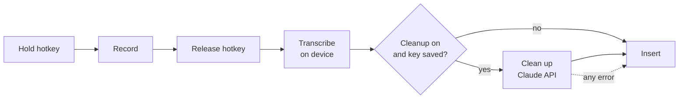

# Utter design notes

Why Utter is built the way it is. Read the [README](../README.md) first for
what it does.

## Goals

- Hold a key, speak, release, and get good text in any app.
- Free to use. At most one API key, and usable with none.
- Private by default: audio stays on the Mac.
- Small enough that one person can read all of it.

## Pipeline

One module owns each box, and `pipeline.rs` runs them in order. The state of
the app (idle, recording, processing) lives only there, so a key press is
interpreted in exactly one place.

## Stack: Tauri, React, TypeScript, Rust

Three things need native code: a global hotkey, the focused app, and pasting.
Everything else is ordinary UI. Tauri fits that split well. The Rust side
handles the native work in one process, with no separate helper to launch and
supervise, and the settings window is a small React app. The release build of
the app is about 7 MB, plus the speech model you choose.

## Transcription: local, not cloud

The default is whisper.cpp running on the Mac. The alternative considered was a
cloud speech-to-text API.

| | Local whisper.cpp | Cloud speech API |
| --- | --- | --- |
| Keys needed | None | A second key. The Claude API does not transcribe audio, so this cannot share the cleanup key. |
| Cost | Free | Paid per minute |
| Privacy | Audio stays on the Mac | Audio is uploaded |
| Works offline | Yes | No |
| Setup | One model download (148 to 574 MB) | Create an account and key |
| Latency, short dictation | About 0.3 s for 10 s of speech with the Base model on an M1 Pro (measured) | Upload plus processing; not measured here, typically around a second |
| Latency, long dictation | Grows with length and model size | Roughly flat |
| Accuracy | Good with Base, better with Small or Large v3 Turbo | Best, especially for names and accents |
| First use after launch | Model takes a moment to load (done in the background at startup) | None |

Local wins on the goals that matter here: one key at most, free, private. The
cost is accuracy on difficult audio, which the larger models and the cleanup
step both help with. A cloud option could be added later as a second
`transcribe` implementation without touching the other stages.

Text is produced once, after release. Streaming partial results while the key
is held would feel livelier but adds a lot of machinery for little gain at
these speeds.

## Cleanup: optional and never in the way

Cleanup is one Messages API request to the fastest current Claude model,
`claude-haiku-5-5`, at low effort.

- **The prompt is in `cleanup.rs`.** A shared part says what to fix (fillers,
  self-corrections, punctuation, misheard words, spoken formatting commands) and
  what not to do (summarise, translate, or answer the dictation). A second part
  is chosen by the kind of app in focus.
- **The transcript is data, not an instruction.** If you dictate "write an email
  to Sam", you get that sentence back, tidied. A reply far longer than the
  dictation is treated as the model answering instead of tidying, and is
  discarded.
- **Failure falls back to the raw transcript.** No key, no network, a timeout,
  a refusal or a truncated reply all end the same way: the raw text is inserted
  and a short note says why.

### Adapting to the app

`context.rs` reads the frontmost app's bundle identifier, which needs no
permission, and maps it to one of six kinds:

| Kind | Examples | Style |
| --- | --- | --- |
| Chat | Slack, Messages, Discord | Conversational, no greeting or sign-off |
| Email | Mail, Outlook | Full sentences, short paragraphs |
| Code | VS Code, Xcode, terminals, JetBrains IDEs | Exact identifiers, no Markdown fences |
| Notes | Notes, Obsidian, Notion, Pages | Clean prose, lists where spoken |
| Assistant | AI chat apps | Clear, direct prompt that keeps every detail |
| Other | Browsers, everything else | Neutral prose |

Only the app's name and kind are sent with the transcript. Utter does not read
the text already in the field or the window's contents.

## The API key

- Entered once in settings, saved to the macOS Keychain (`secrets.rs`).
- Never written to a file, a log, or the settings JSON.
- The UI can ask "is there a key?" but has no way to read it back.
- Sent only in the `x-api-key` header to `api.anthropic.com`.

## Hotkey and permissions

The hotkey is registered with macOS as a system hotkey. macOS then delivers the
press and release to Utter and withholds that combination from other apps. This
needs no permission at all.

The alternative, watching every key event, would allow a lone modifier key as
the trigger but requires Input Monitoring (to listen) or Accessibility (to also
swallow the key). Utter does not do this, so **Input Monitoring is never
requested**.

| Permission | Used for | Asked when |
| --- | --- | --- |
| Microphone | Recording while the hotkey is held | First-run screen |
| Accessibility | Pressing `⌘V` in the focused app | First-run screen; optional |

The first-run screen explains each one, shows its live status, and lists Input
Monitoring as not required so nobody goes looking for it.

## Inserting text

Utter pastes rather than types:

1. Save everything on the clipboard (text, images, files).
2. Put the dictated text on the clipboard, marked so that clipboard managers
   which follow the nspasteboard.org convention do not record it.
3. Press `⌘V`.
4. After a short wait, restore the saved clipboard, unless something else has
   been copied in the meantime.

Pasting works in practically every app and handles any language and any length
in one step. Typing character by character is slow and unreliable outside Latin
scripts. Writing through accessibility APIs fails in many apps.

Fallback: if Accessibility is not granted, or a password field has locked
keyboard input, Utter leaves the text on the clipboard and says so. The last
dictation can also be copied again from the menu-bar icon.

## Distribution

Utter is not signed with an Apple Developer ID, so:

- Gatekeeper blocks a downloaded copy until the user allows it by hand.
- The Accessibility grant is tied to the signature and must be re-granted after
  each update.

Building from source avoids the first problem entirely, so that is the
recommended install route for now. An unsigned release can be offered alongside
it with clear instructions. A Developer ID with notarisation is what would make
a download work on the first double-click and keep permissions across updates.

## Not in this version

- Reading the browser's current site to choose a style.
- A personal dictionary for names and jargon.
- Keeping the microphone warm so the first word is never clipped.
- A history window.
- Windows and Linux.
