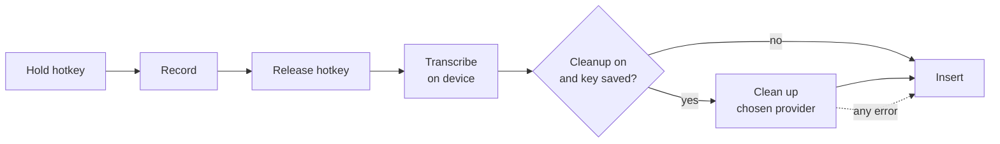

# Utter design notes

Why Utter is built the way it is. Read the [README](../README.md) first for
what it does.

## Goals

- Hold a key, speak, release, and get good text in any app.
- Free to use. At most one API key, from any provider, and usable with none.
- Private by default: audio stays on the Mac.
- Small enough that one person can read all of it.

## Pipeline

One module owns each box, and `pipeline.rs` runs them in order. The state of
the app (idle, recording, processing) lives only there, so a key press is
interpreted in exactly one place.

## Stack: Tauri, React, TypeScript, Rust

Three things need native code: a global hotkey, the focused app, and pasting.
Everything else is ordinary UI. Tauri fits that split well. The Rust side
handles the native work in one process, with no separate helper to launch and
supervise, and the settings window is a small React app. The release build of
the app is about 7 MB, plus the speech model you choose.

## Transcription: local, not cloud

The default is whisper.cpp running on the Mac. The alternative considered was a
cloud speech-to-text API.

| | Local whisper.cpp | Cloud speech API |
| --- | --- | --- |
| Keys needed | None | Often a second key: not every model provider also transcribes audio, so it may not share the cleanup key. |
| Cost | Free | Paid per minute |
| Privacy | Audio stays on the Mac | Audio is uploaded |
| Works offline | Yes | No |
| Setup | One model download (148 to 574 MB) | Create an account and key |
| Latency, short dictation | About 0.3 s for 10 s of speech with the Base model on an M1 Pro (measured) | Upload plus processing; not measured here, typically around a second |
| Latency, long dictation | Grows with length and model size | Roughly flat |
| Accuracy | Good with Base, better with Small (the default) or Large v3 Turbo. On an M1 Pro, 8 s of speech took about 0.75 s with Base, 1.5 s with Small and 6 s with Large v3 Turbo (measured, under load) | Best, especially for names and accents |
| First use after launch | Model takes a moment to load (done in the background at startup) | None |

Local wins on the goals that matter here: one key at most, free, private. The
cost is accuracy on difficult audio, which the larger models and the cleanup
step both help with. A cloud option could be added later as a second
`transcribe` implementation without touching the other stages.

Text is produced once, after release. Streaming partial results while the key
is held would feel livelier but adds a lot of machinery for little gain at
these speeds.

## Cleanup: optional and never in the way

Cleanup is one request to a language model of the user's choosing.

### Any provider

Two wire formats cover practically everything: Anthropic's Messages API, and
the OpenAI-style chat completions API that OpenAI, Google Gemini, Groq,
OpenRouter, Ollama and most others speak. `providers.rs` is a short table of
name, base URL and format; `cleanup.rs` has one small module per format.

- **Anthropic** defaults to the fastest current Claude model,
  `claude-haiku-5-5`, at low effort.
- **Everyone else** gets a request with only `model` and `messages`. Optional
  settings such as token limits are named differently, or rejected, from one
  provider and model to the next, so none are sent.
- **Model names are not hard-coded** for other providers, because they change
  too often. The app asks the provider for its current list instead.
- **A custom base URL must be HTTPS**, or plain HTTP to localhost, so a key
  never crosses the network unencrypted.
- **Ollama needs no key**, which gives a fully local, fully free setup.

- **The prompt is in `cleanup.rs`.** A shared part says what to fix (fillers,
  self-corrections, punctuation, misheard words, spoken formatting commands) and
  what not to do (summarise, translate, or answer the dictation). A second part
  is chosen by the kind of app in focus.
- **The transcript is data, not an instruction.** If you dictate "write an email
  to Sam", you get that sentence back, tidied. A reply far longer than the
  dictation is treated as the model answering instead of tidying, and is
  discarded.
- **Failure falls back to the raw transcript.** No key, no network, a timeout,
  a refusal or a truncated reply all end the same way: the raw text is inserted
  and a short note says why.

### Adapting to the app

`context.rs` reads the frontmost app's bundle identifier, which needs no
permission, and maps it to one of six kinds:

| Kind | Examples | Style |
| --- | --- | --- |
| Chat | Slack, Messages, Discord | Conversational, no greeting or sign-off |
| Email | Mail, Outlook | Full sentences, short paragraphs |
| Code | VS Code, Xcode, terminals, JetBrains IDEs | Exact identifiers, no Markdown fences |
| Notes | Notes, Obsidian, Notion, Pages | Clean prose, lists where spoken |
| Assistant | Claude, ChatGPT | Clear, direct prompt that keeps every detail |
| Other | Everything else | Neutral prose |

In a browser the app says nothing useful: Gmail and claude.ai are both
"Chrome". So for a browser, while the speech is being transcribed, Utter asks
it through the Accessibility API which page the focused field is in: it climbs
from that field to the web area holding it and reads its address, and falls
back to the window title (sites put their own name last). A short list of
known sites maps the address to a name and a kind. Only that name is used,
never the address or the title, which can contain an email subject or a
person's name. The page is only trusted if the browser is still in front when
the answer arrives.

Only the app's (or site's) name and kind are sent with the transcript. Utter
does not read the text already in the field or the window's contents.

### Layout and dashes

A rewrite is told to lay the text out for reading: a paragraph per topic, a
hyphen list for three or more parallel items, nothing forced onto a short
message, and no Markdown beyond those lists. Each kind of destination adds its
own conventions (a greeting on its own line in email, details as a list in an
AI prompt).

Long dictations get the same treatment whichever hotkey was used: the tidy
prompt asks for a new paragraph at each new point, and `cleanup::paragraphs`
is a deterministic safety net. Text over 450 characters with no line break at
all, from a model that ignored the rule or from the speech model alone, is cut
between sentences into paragraphs of at most four sentences or 340
characters, preferring a sentence that opens with a word like "So", "Also" or
"Oh". It never changes a word, never touches text that already has a line
break, and skips code editors and terminals, where a line break means
something.

Every prompt forbids em and en dashes. Models still reach for them, so replies
are also cleaned afterwards: a dash between two parts of a sentence becomes a
comma, one between numbers a hyphen, and one opening a line a list item.
Selected text that already uses dashes keeps them.

### Rewrite mode

A second hotkey runs the same pipeline with a different instruction: say the
same thing better, rather than keep the wording. It is a separate hotkey, not
a setting, because the choice is made per sentence: you tidy a quick reply and
rewrite a rambling one, seconds apart.

- **Styles** are short instructions appended to a shared rewrite prompt: four
  presets, or the user's own text.
- **The rewrite hotkey ignores the cleanup on/off switch.** Pressing it is an
  explicit request for the model.
- **The same limits apply as for tidying** with the presets: keep every point,
  add nothing, never answer the dictation.

### Checking the reply

The model's reply is typed into someone's document unseen, so it is checked
first, and anything that fails falls back to the raw transcript.

| Job | A reply is accepted when |
| --- | --- |
| Tidy | Nearly every word in it was spoken (numbers, and spoken words run together into an identifier, count as spoken), it does not open or close with new material, and most of what was said survives. |
| Rewrite, preset style | The longer words mostly carry over in both directions; for a short dictation, it reuses many of its words and stays short. |
| Rewrite, your own instruction | It is not wildly longer than the dictation. The instruction may ask for a translation or an expansion, so resemblance is not required. |

These checks exist because small models do sometimes reply to their
instructions, answer the dictation, or wrap the text in a remark. They are
heuristics: they catch chatter and answers, not a subtly wrong word.

### Long dictations

The speech model reads audio in 30-second windows. Left to walk through a long
recording by itself it drops words where windows meet and can get stuck
repeating a phrase. Utter instead cuts a long recording at the quietest moment
it can find between 12 and 27 seconds, which in speech is a pause, and
transcribes each piece as its own short dictation. On a 95-second test
monologue this recovered 97.7% of the words.

### Silence, wind and noise

Whisper learned from subtitled video, so given audio with nobody talking it
writes what subtitles say then: "you", "Thank you.", ".", a stray word. In one
user's history 7 of 78 dictations were exactly that, all from clips of 0.7 to
3 seconds. Four checks now stand between noise and the cursor, in order:

1. **High-pass filter** (`audio::high_pass`): 4th-order Butterworth at 100 Hz.
   Wind on the microphone, traffic and desk thumps are mostly below it; 50 Hz
   comes out 24 dB quieter, 25 Hz 48 dB, and above 150 Hz less than 0.2 dB is
   lost. Ordinary voices keep 99% of their level. A deep test voice (pitch
   84-107 Hz) loses 1.3 dB of its fundamental but none of the harmonics that
   carry the words; Base wrote exactly the same text for all four test clips
   with the filter as without, and did better with it on the deep voice spoken
   quietly over room noise.
2. **Voice activity** (`speech::Vad`): Silero VAD v6.2.0 (885 KB, from
   ggml-org on Hugging Face, fetched with the first speech model or on the
   next start for anyone who already has one). A recording with less than
   250 ms of speech in it is not transcribed; in one that is, only the
   stretches of speech (padded 200 ms each side, pauses under 300 ms kept)
   reach the speech model. Frame threshold 0.5, Silero's own default: it
   judges the shape of the sound rather than its loudness, and found 1.8 s of
   speech in a 2 s sentence at -42 dBFS while finding 0 ms in silence, room
   noise, a fan, loud hiss and four kinds of wind gusts. whisper.cpp can run
   the same model itself, but only from `whisper_full`; whisper-rs calls
   `whisper_full_with_state`, which ignores the setting, so Utter runs it.
   Until the model is here, the old loudness check stands in.
3. **Per-segment confidence** (`speech::keep_segment`). whisper.cpp's own
   no-speech estimate is read one token too late when timestamps are off,
   and is always about 0.00002, so Utter asks the model itself: one decoder
   step after "start of transcript", the chance the next token is "no
   speech", as Whisper was published. Given noise with nothing to stop it,
   Whisper wrote "you", "Shh." or "." at 0.77 to 0.92; speech, however quiet
   or windy, never went above 0.46, and its mean log-probability never below
   -0.69. A segment is dropped at 0.7 or above whatever its words (leaning
   towards keeping words, since losing a dictation costs more than a rare
   stray word), at 0.6 with a log-probability under -1.0 (Whisper's own
   rule), or under -1.5 log-probability alone (noise came out at -1.5 to
   -1.9; accented speech can reach -1.2).
4. **Known inventions** (`speech::is_invented`). With under 700 ms of speech,
   a transcript that is only "you", "Thank you.", "Thanks for watching!",
   "Bye", "." and the like is dropped unless the model was sure (no-speech at
   most 0.4, log-probability at least -0.4: a quiet "Thank you." measured
   0.19 and -0.14). Any other lone word is dropped if no-speech reached 0.5
   or log-probability fell under -1.0; a quiet "Yes." measured 0.40 and
   -0.61. With 700 ms or more nothing is second-guessed.

A recording turned away by any of these shows "Didn't hear any speech." in the
pill, as a note rather than an error, and types nothing. A recording with no
sound at all (peak under 0.003) still gets the microphone advice.

The figures come from `src-tauri/tests/noise.rs`: speech rendered with macOS
voices (`tests/fixtures/render.sh`) at normal, -34 and -42 dBFS, over room
noise, a fan and gusts, against silence, hiss, gusts with and without
broadband hiss, a breath and typing. They were measured with Base; the larger
models were not measured. `cargo test --test noise -- --ignored --nocapture`
runs the real models over all of it and prints the figures.

### Speaking over a fan

A fan does not make the speech model invent words so much as mishear real
ones. `src-tauri/examples/fan_wer.rs` measures it: ten jargon-heavy sentences
("Rebase the feature branch onto main and squash the WIP commits.") in two
macOS voices, over a synthetic fan (pink hiss, a brown rumble, 60 Hz hum with
two harmonics and a 140 Hz blade tone), at 20, 10 and 5 dB below the speech's
active level, each mix three times with a different stretch of fan noise.
About 10 dB is a desk fan a metre or two away from a laptop microphone. Word
error rate, punctuation and case ignored, about 220 words clean and 660 per
noisy cell:

| Model | Front-end | Clean | 20 dB | 10 dB | 5 dB |
| --- | --- | --- | --- | --- | --- |
| Base (English) | Raw | 19.4% | 20.9% | 27.2% | 37.2% |
| | High-pass | 19.8% | 19.8% | 26.1% | 37.7% |
| | High-pass + voice activity (shipped) | 18.0% | 18.6% | 24.9% | 38.4% |
| | RNNoise + shipped | 18.9% | 17.1% | 27.0% | 41.0% |
| Large v3 Turbo | Raw | 6.8% | 8.1% | 9.0% | 14.7% |
| | High-pass | 6.3% | 8.1% | 10.4% | 15.8% |
| | High-pass + voice activity (shipped) | 5.9% | 7.7% | 10.4% | 14.9% |
| | RNNoise + shipped | 5.9% | 7.4% | 14.7% | 17.0% |

Mix by mix against the shipped front-end, the differences between Raw,
High-pass and shipped are within chance (Large at 10 dB: Raw better on 12
mixes, worse on 9). What the numbers do say:

- **The model is the lever.** Large v3 Turbo makes a third to a half as many
  errors as Base at every noise level, and over a fan at 10 dB it is still
  better than Base in silence. For dictating over a fan, use Large.
- **The high-pass and voice activity checks cost nothing in accuracy.** They
  are there for silence and wind (above); over a fan they neither help nor
  hurt measurably.
- **RNNoise hurts where it is needed.** The neural noise suppressor used in
  many call apps helps a little at 20 dB but makes things worse at 10 dB
  (Base: better on 16 mixes, worse on 24; Large: 5 and 20) and at 5 dB. A
  suppressor reshapes the speech along with the noise, and Whisper, which
  learned from unprocessed audio, hears the difference. It is kept only in
  the measurement, as a development dependency.

macOS voice processing (the noise suppression FaceTime uses, through
AVAudioEngine) could not be measured the same way: AVAudioEngine refuses it in
offline rendering (error -10863), and the only virtual audio device here
passes no sound unless its own app is running. Measuring it would mean playing
the mixes aloud through the speakers and recording them with it on and off.
Given what RNNoise did, and its known costs, it was left out without that
measurement: it ducks every other app's sound while the microphone is open,
which a hold-to-talk tool would do dozens of times a day; it reshapes the
voice with gain control and suppression tuned for calls, which speech models
were not trained on; and it would mean a second capture path beside cpal.

Since no front-end clearly helps, there is no "Noisy room" setting.

### Working while the user talks

A dictation used to start being processed when the key came up, so the wait
grew with its length: a 95-second dictation took 2.7 s to transcribe and 17 s
to tidy with a 4B model on an M1 Pro. Now, every 1.5 s while recording, the
audio so far is checked for a clear pause (450 ms, at least 6 s of speech
before it, at least 1 s behind the live edge). Everything up to that pause is
transcribed and, for the dictation hotkey, tidied in the background. When the
key comes up, only the rest is. The pieces of text are rejoined into running
prose (the model's own paragraph breaks inside a few seconds of speech are
dropped; lists are kept) and laid out in paragraphs once. In testing the
95-second dictation was typed 0.3 s after release, with the same words as
transcribing it whole (99.7% identical).

The rewrite hotkey still sends the whole dictation to the model at the end,
because rewriting needs all of it. A short dictation the speech model wrote
cleanly skips the model altogether (`cleanup::already_clean`). A local model
is asked to stay loaded for an hour.

`UTTER_SIMULATE_LIVE=1` replays a simulated recording as if it were arriving
live, to compare against transcribing it whole.

### Models that reason first

Some hosted models think before answering (Groq's GPT-OSS and Qwen 3 models,
for example). For light editing that only adds delay, and the thinking must
never reach the text. Where the provider is known to accept it (Groq), Utter
asks for low or no reasoning effort and for the reasoning to be left out of
the reply. Elsewhere it sends only the standard fields, because some providers
reject settings they do not know. Any reasoning that still arrives inside
`<think>` tags is cut off before the reply is checked.

### Local models

With Ollama, Utter asks the server to load the model as soon as the key goes
down, so the load happens while the user is still speaking. Requests to a
local model are also given longer before Utter gives up and uses the raw text.

## The API key

- Entered in settings, saved to the macOS Keychain (`secrets.rs`), one entry
  per provider.
- Never written to a file, a log, or the settings JSON.
- The UI can ask "is there a key?" but has no way to read it back.
- The key for a custom service is forgotten if its base URL is changed to a
  different host, so it can never be sent somewhere it was not meant for.
- Sent only in a request header, and only to the provider it belongs to.

## Hotkey and permissions

The hotkey is registered with macOS as a system hotkey. macOS then delivers the
press and release to Utter and withholds that combination from other apps. This
needs no permission at all.

A lone modifier key cannot be registered that way. For the fn key, which users
asked for, Utter installs an event tap. A tap that is allowed to act on events
needs Accessibility, which Utter already has for pasting; a listen-only tap
would need Input Monitoring instead, so the tap is the acting kind and passes
everything through unchanged. It is consulted only for fn going down and up
and for "another key went down while fn is held", in which case fn is part of
a shortcut and the recording is dropped without a note. Which key that was is
never read. If the tap cannot be made (Accessibility not yet allowed), it is
retried every two seconds, and the Hotkey tab says why fn is not working.
**Input Monitoring is never requested.**

macOS's own globe-key action ("Press 🌐 key to": emoji picker, input source,
Apple's dictation) would fire as well. It runs in the window server before any
event tap, so dropping fn's events does not stop it (tried, on a real Mac: the
picker still opened). The only cure is that setting being "Do Nothing". Unless
the user has switched it off (`quietGlobe`, on by default), `globe.rs` sets it
to Do Nothing while fn is the hotkey and gives it back on quit, on choosing
another hotkey, or on request. It uses the same calls Keyboard settings does
(`TISGetFnUsageType` / `TISUpdateFnUsageType`, looked up at run time), which
apply at once, and writes the original value to a file first so a crashed
run's next launch can still restore it. A value the user changed in the
meantime is left alone, and so is a saved "off" from the Hotkey tab.

What the tap does (installed or not, fn down and up, fn dropped from a
shortcut) is written to `~/Library/Logs/Utter/fn-key.log`; nothing else about
the keyboard is.
Shortcuts that use fn keep working, because the keys pressed with fn carry the
fn flag themselves. As a backstop the Hotkey tab reads the setting and, if it
is not "Do Nothing", links to Keyboard settings. Utter never changes the
setting itself.

| Permission | Used for | Asked when |
| --- | --- | --- |
| Microphone | Recording while you dictate | First-run screen |
| Accessibility | Pressing `⌘V` in the focused app; reading the selection | First-run screen; optional |

The first-run screen explains each one, shows its live status, and lists Input
Monitoring as not required so nobody goes looking for it.

### Hold or tap

Holding the hotkey is the main gesture: the release is an unambiguous "done".
A press released within 300 ms is a tap. A second press within 400 ms of it
makes a double tap, which turns the recording (already running since the first
press) hands-free until the next tap of either hotkey. A single tap on its own
is let go after those 400 ms, with a reminder of how to start. A double tap
rather than a single one, because a single tap of fn happens by accident far
too often.

Nobody is holding a key during a hands-free recording, so it has to be able to
end without the user: after 30 seconds below speaking level, or at the five
minute cap. A recording that ends that way is copied, never typed, because the
focused app may have changed since the user last looked. A *held* recording
that reaches the cap is still discarded: that is a lost key-up event, not
something the user said on purpose.

### A microphone that is ready

Opening an input stream takes a few hundred milliseconds, which used to clip
the first word. The stream is now built ahead of time and kept paused; starting
it takes tens of milliseconds. A paused stream captures nothing and the
system's microphone indicator stays off. It is rebuilt when the default input
device changes. Bluetooth devices are the exception: holding an input stream,
even a paused one, can keep a headset in its low-quality call mode, so for
those the stream is closed after each dictation and the old delay remains.

## Inserting text

Utter pastes rather than types:

0. Find the key that types "v" on the current keyboard layout. Apps match
   `⌘V` by letter, so the QWERTY position is wrong on Dvorak and others.
1. Save everything on the clipboard (text, images, files).
2. Put the dictated text on the clipboard, marked so that clipboard managers
   which follow the nspasteboard.org convention do not record it.
3. Press `⌘V`.
4. After a short wait, restore the saved clipboard, unless something else has
   been copied in the meantime.

Pasting works in practically every app and handles any language and any length
in one step. Typing character by character is slow and unreliable outside Latin
scripts. Writing through accessibility APIs fails in many apps.

Fallback: if Accessibility is not granted, or a password field has locked
keyboard input, Utter leaves the text on the clipboard and says so. The last
dictation can also be copied again from the menu-bar icon.

## Editing the selection

With the rewrite hotkey, selected text turns the spoken words into an
instruction ("make this shorter") and the reply replaces the selection.

Finding the selection, in order:

1. Ask the focused element for its selected text through the accessibility
   API. Web-based apps only answer once asked to, so the app is nudged when the
   hotkey goes down and read when it comes up.
2. If the app gives no answer either way, press `⌘C` and see whether the
   clipboard changes, then put the clipboard back. Skipped in code editors,
   where copying with nothing selected takes the whole line.

Replacing it is the ordinary paste, which overwrites a selection. The rule that
matters is the failure mode: if the model fails, or its reply is rejected,
nothing is pasted. Falling back to "insert the raw words", the right thing for
a dictation, would here replace the user's paragraph with "make this shorter".

## Your words

The dictionary is used twice. The speech model takes it as an initial prompt
("Glossary: ..."), which biases it towards those spellings; the cleanup model
is told the same list is how those words are written. The reply check allows
the listed terms, since the model may correctly introduce a spelling that the
transcript did not contain. The list is capped (200 entries, and a character
budget for the speech prompt) because a long prompt slows transcription and a
huge glossary starts to be heard where it was not said.

Each word may also carry what the speech model wrote instead ("heard as"),
lower case. Those come from the user, from fixing a word in a past dictation,
or from learning. Older settings files hold plain strings; they still load.
Removed words go on a "forgotten" list so learning never brings them back,
and adding one by hand takes it off that list again.

A mishearing is usually a real word ("cloud"), so it is never replaced
blindly. Before cleanup, `words::suspects` looks for places where one of the
user's words may have been misheard: a taught mishearing, or a word (or two
short ones run together, "pre a" for Priya) that shares its Soundex key with
one of the user's words and at least half its spelling. Any hit sends the
dictation to the cleanup model even when it would otherwise skip it as already
clean, and the prompt names each suspect ("cloud" may be Claude) and asks the
model to decide from the sentence and the destination. On a 4B local model
this put eight test sentences right, including leaving "the cloud bill" alone
(`cargo test live_words -- --ignored`, against Ollama).

### Learning from corrections

After a paste, `learn::watch` takes the focused element through the
Accessibility API (never a password field) and reads its value. If the pasted
text is in it, the element is read again every 300 ms for up to a minute. The
watch ends when the user has stopped changing it for four seconds, moved to
another element, the text was sent or cleared (the last reading before that is
used), or another dictation began. Only then is anything compared.

The comparison squeezes white space, trims the common start and end, and
lines up the remaining words. Each run of up to three of Utter's words that
the user replaced with up to three others, inside the pasted text, is a
candidate. It is learned only if the new text sounds like the old (shared
Soundex key and half the spelling, or only spacing or case changed) and is a
name or term: one of its words has odd capitals or digits, or is not an
everyday word. Everyday means written in lower case in the system word list
(`/usr/share/dict/words`, where names are capitalised), plus a short list of
modern words that list lacks. At most three per dictation. Words and
mishearings the user removed are on the forgotten list and are skipped.

A learned word is announced in the pill (unless a dictation is showing), in
the window, and as **Undo Learning** in the menu bar. The text of the box is
never logged; the log records only that a watch ended, why, and how many
words were edited. What is stored is described under "Measuring accuracy".

### Names on screen

At key-down, on a thread of its own, `selection::window_text` walks the
focused window's accessibility tree breadth first (at most 800 elements,
600 ms and 30,000 characters) and collects titles, labels and text-box
values, skipping password fields. `screen::terms` keeps what looks like a
name: odd capitals or digits, snake_case, or a capitalised word that is not
everyday English; web and email addresses, file names and hashes are left
out, as are the user's own and forgotten words. The 40 most frequent are kept
in memory for that recording only.

They are hints, weaker than the user's words: the 12 most frequent join the
speech model's prompt after the user's words, and cleanup is told they are on
screen "in case they say one" and never to add one that was not said. They
also count as suspects, so a dictation with something that sounds like one,
or an identifier said as its words ("fetch user profile"), goes to the model.

In the same thread, before the names, `selection::around_cursor` reads the
text box in focus: its value up to the cursor (`AXSelectedTextRange`, counted
in UTF-16 units), and then the text of ever larger ancestors of the box, in
reading order, until there is enough (500 ms and 600 elements at most). With
`screen_context` on (Send nearby text to cleanup, off by default) and a
destination that is not Code, up to 1,500 characters of that, four fifths
from before the box, go to cleanup as `<screen>`, and the last 600
characters before the cursor as `<before>`, both marked read-only and used
only to resolve mishearings and to continue a sentence. `cleanup::as_material`
turns angle brackets in it into look-alikes, so text on screen cannot close
the tags, and leaves out anything shaped like a key or token. The names are
read on a thread of their own alongside, so a slow window does not delay
them. `pipeline::follow_on` uses the text before the cursor, on this Mac
whatever that setting, to add a leading space and lower-case a word that is
never a name (`RUN_ON_WORDS`) when the dictation carries on a sentence. It
adds no space after an opening quote or between Chinese or Japanese, and
does nothing in Code. None of it is stored, and it is skipped for password fields and
while secure input is on. Screen names are only listed for cleanup when the
transcript has one, or a word whose whole sound key (Soundex without the cut
after three consonant groups) matches, so "whisper" never becomes
"Whisperflow".

After the dictation, a screen term that made it into the text is counted in
`settings.suggested`. It is offered in the window once the speech model had
misheard it (the screen put it right) or after a second use; never added
without the user. A local 4B model handled names reliably in testing and
identifiers said as words only about half the time.

## History

Finished dictations are appended to one JSON file in the app's data folder,
written to a temporary file and renamed, with owner-only permissions. The 200
most recent are kept. It can be switched off, cleared, or pruned one entry at a
time. Nothing reads it except the window. It is plain JSON rather than a
database because it is small, bounded and the user should be able to open it.

### Measuring accuracy

What matters is whether the user had to touch what Utter typed, so that is
what is measured. The watch that learns words (above) also runs
`accuracy::edit` when it ends: the pasted words are found in the box as it
was just after the paste, the user's own text around them must be unchanged
(otherwise the result is "unclear" and nothing is recorded), and the words
between are compared with what was pasted. Words typed straight after or
before the dictation are carrying on, not correcting. The word-level edit
distance is stored on the dictation as `edit.changed`; a Fix on Home or History adds
to it. The edit rate is the share of followed dictations with none.

The watch runs while learning is on or recordings are kept. With both off,
Utter does not read the box and nothing is counted.

**Keep recordings** (off by default) writes each dictation's audio as 16-bit,
16 kHz mono WAV to `recordings/<finished_at>.wav`, owner-only, in a folder
that is owner-only too. The history entry names its file. After every change
to the history, `recordings::tidy` keeps the newest 50 that an entry names
and deletes every other file of that form, so a recording never outlives its
entry; the corrected text (`edit.corrected`) is kept only beside a recording
and goes with it. Switching the setting off deletes them all.

`examples/replay.rs` reads the history and recordings directly, transcribes
each recording with every `--model`, tidies with every `--cleanup` the way
`pipeline::improve` does (through the same `cleanup::goes_as_is`, prompt and
`paragraphs`), and scores the result against a hand label, the corrected
text, or the accepted text, in that order. It reports a normalised word error
rate and the raw word edits, which is what the app counts. It transcribes
each recording whole, where the app works on pieces while the user speaks, so
its times are an upper bound.

## The interface

Most of the time the only thing on screen is the status pill, so it gets the
most care. The settings window is opened rarely and should answer one question
at a glance: is Utter ready, and if not, what is the one thing to do?

The look is "Quiet" in light and "Graphite" in dark, from a design handoff.
Tokens are custom properties on `.q-light` and `.q-dark` in
`src/styles/quiet.css`; the root element carries one or the other, following
the system appearance. `app.css` holds what the real windows add (scrolling,
the folded sidebar, menus, the pill window).

- **One big value per card.** Each card leads with the thing it measures:
  Ready, 0.91 s, Base, Allowed. Everything else supports it.
- **Colour means status.** Mint is good, peach needs you, red only when
  dictation can't happen (no microphone, a broken hotkey). Nothing else is
  coloured, so a coloured thing always matters. At most one filled button per
  screen: the next thing to do.
- **Readiness has a fixed order.** The status card at the foot of the sidebar
  shows the first of: something under way (listening, working, recording a
  hotkey), microphone not allowed, hotkey not working, model downloading,
  model missing, cleanup unable to run, Accessibility off, ready. Clicking it
  opens the section that fixes it, which carries a `!` badge. The same words go
  to the menu bar (`set_tray_status`), whose icon moves while listening or
  working and carries a dot when something needs the user.
- **The pill never takes focus.** Its window is transparent, always on top and
  ignores the mouse, so it carries state only. Success is silent.
- **The waveform is real.** While recording, the backend sends the microphone
  level about twenty times a second (`audio-level`, 0 to 1 for -60 dB to
  -12 dB), rising fast and falling slower so speech looks lively without
  flickering.
- **Sections in a sidebar.** Home, History and Words at the top; then the
  settings in a group that folds away and remembers being folded (a section
  with a `!`, or the one open, stays in view either way): Hotkeys, Speech,
  Cleanup, AI provider, Privacy, General; About at the foot. Each setting
  lives in one place. Everything Utter keeps, reads or sends is on Privacy,
  with a summary of what leaves the Mac for the current settings. The
  language model is its own section because cleanup and rewrite both use it.
  Below 680 px wide the sidebar folds to icons. Rewrite has no section of its
  own: its hotkey sits beside the dictation hotkey, and its style with
  Cleanup.
- **Before and after.** The last dictation can be read as heard, as written, or
  as the changes between the two. The wait after letting go is the big number;
  three tiles split it into transcribing, the model, and inserting.
- **Type.** The macOS system font, with tabular figures for every number.
  Nothing is bundled or loaded from the network.
- **Reduced motion.** Loops stop and the status words carry the meaning.

### Updates

About shows the version and can ask GitHub for the latest release
(`updates.rs`): one unauthenticated request to the releases API, nothing else
sent. It happens when the user presses Check for updates or chooses Check for
Updates… in the menu bar, and once a day only if they switch on Check
automatically, which is off by default because it is a network request. A
newer release is offered as a link to its GitHub page; Utter does not download
or install anything itself.

### Quitting

whisper.cpp's Metal backend asserts at process exit if a model is still
loaded, which macOS reports as a crash. On the way out (`RunEvent::Exit`)
Utter gives back the globe-key setting and then drops the loaded model, waiting
up to two seconds for a transcription in progress.

## Distribution

Releases are signed with a Developer ID (hardened runtime, secure timestamp)
and, when the maintainer's notarisation credentials are present, notarised and
stapled; `scripts/release.sh` does all of it and reads the identity and the
notary profile from the environment, so neither is in the repository. A
Developer ID signature has a stable designated requirement (bundle id plus
team), so macOS keeps the Microphone and Accessibility grants across updates;
ad-hoc builds lose them on every rebuild, which is why the permissions list
has a "Reset it" link that clears the stale entry and asks again.

A local build is never quarantined, so it opens without Gatekeeper asking.

## Not in this version

- Starting a new dictation while the previous one is still being processed.
- Learning from corrections, or remembering anything about the user beyond the
  word list they write themselves.
- A signed, notarised build with automatic updates.
- Windows and Linux.
