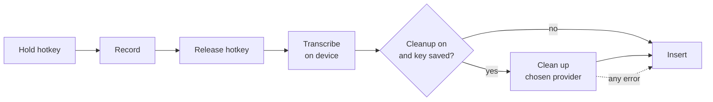

# Utter design notes

Why Utter is built the way it is. Read the [README](../README.md) first for
what it does.

## Goals

- Hold a key, speak, release, and get good text in any app.
- Free to use. At most one API key, from any provider, and usable with none.
- Private by default: audio stays on the Mac.
- Small enough that one person can read all of it.

## Pipeline

One module owns each box, and `pipeline.rs` runs them in order. The state of
the app (idle, recording, processing) lives only there, so a key press is
interpreted in exactly one place.

## Stack: Tauri, React, TypeScript, Rust

Three things need native code: a global hotkey, the focused app, and pasting.
Everything else is ordinary UI. Tauri fits that split well. The Rust side
handles the native work in one process, with no separate helper to launch and
supervise, and the settings window is a small React app. The release build of
the app is about 7 MB, plus the speech model you choose.

## Transcription: local, not cloud

The default is whisper.cpp running on the Mac. The alternative considered was a
cloud speech-to-text API.

| | Local whisper.cpp | Cloud speech API |
| --- | --- | --- |
| Keys needed | None | Often a second key: not every model provider also transcribes audio, so it may not share the cleanup key. |
| Cost | Free | Paid per minute |
| Privacy | Audio stays on the Mac | Audio is uploaded |
| Works offline | Yes | No |
| Setup | One model download (148 to 574 MB) | Create an account and key |
| Latency, short dictation | About 0.3 s for 10 s of speech with the Base model on an M1 Pro (measured) | Upload plus processing; not measured here, typically around a second |
| Latency, long dictation | Grows with length and model size | Roughly flat |
| Accuracy | Good with Base, better with Small or Large v3 Turbo | Best, especially for names and accents |
| First use after launch | Model takes a moment to load (done in the background at startup) | None |

Local wins on the goals that matter here: one key at most, free, private. The
cost is accuracy on difficult audio, which the larger models and the cleanup
step both help with. A cloud option could be added later as a second
`transcribe` implementation without touching the other stages.

Text is produced once, after release. Streaming partial results while the key
is held would feel livelier but adds a lot of machinery for little gain at
these speeds.

## Cleanup: optional and never in the way

Cleanup is one request to a language model of the user's choosing.

### Any provider

Two wire formats cover practically everything: Anthropic's Messages API, and
the OpenAI-style chat completions API that OpenAI, Google Gemini, Groq,
OpenRouter, Ollama and most others speak. `providers.rs` is a short table of
name, base URL and format; `cleanup.rs` has one small module per format.

- **Anthropic** defaults to the fastest current Claude model,
  `claude-haiku-5-5`, at low effort.
- **Everyone else** gets a request with only `model` and `messages`. Optional
  settings such as token limits are named differently, or rejected, from one
  provider and model to the next, so none are sent.
- **Model names are not hard-coded** for other providers, because they change
  too often. The app asks the provider for its current list instead.
- **A custom base URL must be HTTPS**, or plain HTTP to localhost, so a key
  never crosses the network unencrypted.
- **Ollama needs no key**, which gives a fully local, fully free setup.

- **The prompt is in `cleanup.rs`.** A shared part says what to fix (fillers,
  self-corrections, punctuation, misheard words, spoken formatting commands) and
  what not to do (summarise, translate, or answer the dictation). A second part
  is chosen by the kind of app in focus.
- **The transcript is data, not an instruction.** If you dictate "write an email
  to Sam", you get that sentence back, tidied. A reply far longer than the
  dictation is treated as the model answering instead of tidying, and is
  discarded.
- **Failure falls back to the raw transcript.** No key, no network, a timeout,
  a refusal or a truncated reply all end the same way: the raw text is inserted
  and a short note says why.

### Adapting to the app

`context.rs` reads the frontmost app's bundle identifier, which needs no
permission, and maps it to one of six kinds:

| Kind | Examples | Style |
| --- | --- | --- |
| Chat | Slack, Messages, Discord | Conversational, no greeting or sign-off |
| Email | Mail, Outlook | Full sentences, short paragraphs |
| Code | VS Code, Xcode, terminals, JetBrains IDEs | Exact identifiers, no Markdown fences |
| Notes | Notes, Obsidian, Notion, Pages | Clean prose, lists where spoken |
| Assistant | Claude, ChatGPT | Clear, direct prompt that keeps every detail |
| Other | Everything else | Neutral prose |

In a browser the app says nothing useful: Gmail and claude.ai are both
"Chrome". So for a browser, while the speech is being transcribed, Utter asks
it through the Accessibility API which page the focused field is in: it climbs
from that field to the web area holding it and reads its address, and falls
back to the window title (sites put their own name last). A short list of
known sites maps the address to a name and a kind. Only that name is used,
never the address or the title, which can contain an email subject or a
person's name. The page is only trusted if the browser is still in front when
the answer arrives.

Only the app's (or site's) name and kind are sent with the transcript. Utter
does not read the text already in the field or the window's contents.

### Layout and dashes

A rewrite is told to lay the text out for reading: a paragraph per topic, a
hyphen list for three or more parallel items, nothing forced onto a short
message, and no Markdown beyond those lists. Each kind of destination adds its
own conventions (a greeting on its own line in email, details as a list in an
AI prompt).

Long dictations get the same treatment whichever hotkey was used: the tidy
prompt asks for a new paragraph at each new point, and `cleanup::paragraphs`
is a deterministic safety net. Text over 450 characters with no line break at
all, from a model that ignored the rule or from the speech model alone, is cut
between sentences into paragraphs of at most four sentences or 340
characters, preferring a sentence that opens with a word like "So", "Also" or
"Oh". It never changes a word, never touches text that already has a line
break, and skips code editors and terminals, where a line break means
something.

Every prompt forbids em and en dashes. Models still reach for them, so replies
are also cleaned afterwards: a dash between two parts of a sentence becomes a
comma, one between numbers a hyphen, and one opening a line a list item.
Selected text that already uses dashes keeps them.

### Rewrite mode

A second hotkey runs the same pipeline with a different instruction: say the
same thing better, rather than keep the wording. It is a separate hotkey, not
a setting, because the choice is made per sentence: you tidy a quick reply and
rewrite a rambling one, seconds apart.

- **Styles** are short instructions appended to a shared rewrite prompt: four
  presets, or the user's own text.
- **The rewrite hotkey ignores the cleanup on/off switch.** Pressing it is an
  explicit request for the model.
- **The same limits apply as for tidying** with the presets: keep every point,
  add nothing, never answer the dictation.

### Checking the reply

The model's reply is typed into someone's document unseen, so it is checked
first, and anything that fails falls back to the raw transcript.

| Job | A reply is accepted when |
| --- | --- |
| Tidy | Nearly every word in it was spoken (numbers, and spoken words run together into an identifier, count as spoken), it does not open or close with new material, and most of what was said survives. |
| Rewrite, preset style | The longer words mostly carry over in both directions; for a short dictation, it reuses many of its words and stays short. |
| Rewrite, your own instruction | It is not wildly longer than the dictation. The instruction may ask for a translation or an expansion, so resemblance is not required. |

These checks exist because small models do sometimes reply to their
instructions, answer the dictation, or wrap the text in a remark. They are
heuristics: they catch chatter and answers, not a subtly wrong word.

### Long dictations

The speech model reads audio in 30-second windows. Left to walk through a long
recording by itself it drops words where windows meet and can get stuck
repeating a phrase. Utter instead cuts a long recording at the quietest moment
it can find between 12 and 27 seconds, which in speech is a pause, and
transcribes each piece as its own short dictation. On a 95-second test
monologue this recovered 97.7% of the words.

### Local models

With Ollama, Utter asks the server to load the model as soon as the key goes
down, so the load happens while the user is still speaking. Requests to a
local model are also given longer before Utter gives up and uses the raw text.

## The API key

- Entered in settings, saved to the macOS Keychain (`secrets.rs`), one entry
  per provider.
- Never written to a file, a log, or the settings JSON.
- The UI can ask "is there a key?" but has no way to read it back.
- The key for a custom service is forgotten if its base URL is changed to a
  different host, so it can never be sent somewhere it was not meant for.
- Sent only in a request header, and only to the provider it belongs to.

## Hotkey and permissions

The hotkey is registered with macOS as a system hotkey. macOS then delivers the
press and release to Utter and withholds that combination from other apps. This
needs no permission at all.

A lone modifier key cannot be registered that way. For the fn key, which users
asked for, Utter installs an event tap. A tap that is allowed to act on events
needs Accessibility, which Utter already has for pasting; a listen-only tap
would need Input Monitoring instead, so the tap is the acting kind and passes
everything through unchanged. It is consulted only for fn going down and up
and for "another key went down while fn is held", in which case fn is part of
a shortcut and the recording is dropped without a note. Which key that was is
never read. If the tap cannot be made (Accessibility not yet allowed), it is
retried every two seconds, and the Hotkey tab says why fn is not working.
**Input Monitoring is never requested.**

macOS's own globe-key action ("Press 🌐 key to": emoji picker, input source,
Apple's dictation) would fire as well. So while fn is the hotkey, the tap
drops fn's own down and up events (key code 63) at the head of the session
event queue, before any app sees them. What the tap does (installed or not,
fn down and up, fn dropped from a shortcut) is written to
`~/Library/Logs/Utter/fn-key.log`; nothing else about the keyboard is.
Shortcuts that use fn keep working, because the keys pressed with fn carry the
fn flag themselves. As a backstop the Hotkey tab reads the setting and, if it
is not "Do Nothing", links to Keyboard settings. Utter never changes the
setting itself.

| Permission | Used for | Asked when |
| --- | --- | --- |
| Microphone | Recording while you dictate | First-run screen |
| Accessibility | Pressing `⌘V` in the focused app; reading the selection | First-run screen; optional |

The first-run screen explains each one, shows its live status, and lists Input
Monitoring as not required so nobody goes looking for it.

### Hold or tap

Holding the hotkey is the main gesture: the release is an unambiguous "done".
A press released within 300 ms is a tap. A second press within 400 ms of it
makes a double tap, which turns the recording (already running since the first
press) hands-free until the next tap of either hotkey. A single tap on its own
is let go after those 400 ms, with a reminder of how to start. A double tap
rather than a single one, because a single tap of fn happens by accident far
too often.

Nobody is holding a key during a hands-free recording, so it has to be able to
end without the user: after 30 seconds below speaking level, or at the five
minute cap. A recording that ends that way is copied, never typed, because the
focused app may have changed since the user last looked. A *held* recording
that reaches the cap is still discarded: that is a lost key-up event, not
something the user said on purpose.

### A microphone that is ready

Opening an input stream takes a few hundred milliseconds, which used to clip
the first word. The stream is now built ahead of time and kept paused; starting
it takes tens of milliseconds. A paused stream captures nothing and the
system's microphone indicator stays off. It is rebuilt when the default input
device changes. Bluetooth devices are the exception: holding an input stream,
even a paused one, can keep a headset in its low-quality call mode, so for
those the stream is closed after each dictation and the old delay remains.

## Inserting text

Utter pastes rather than types:

0. Find the key that types "v" on the current keyboard layout. Apps match
   `⌘V` by letter, so the QWERTY position is wrong on Dvorak and others.
1. Save everything on the clipboard (text, images, files).
2. Put the dictated text on the clipboard, marked so that clipboard managers
   which follow the nspasteboard.org convention do not record it.
3. Press `⌘V`.
4. After a short wait, restore the saved clipboard, unless something else has
   been copied in the meantime.

Pasting works in practically every app and handles any language and any length
in one step. Typing character by character is slow and unreliable outside Latin
scripts. Writing through accessibility APIs fails in many apps.

Fallback: if Accessibility is not granted, or a password field has locked
keyboard input, Utter leaves the text on the clipboard and says so. The last
dictation can also be copied again from the menu-bar icon.

## Editing the selection

With the rewrite hotkey, selected text turns the spoken words into an
instruction ("make this shorter") and the reply replaces the selection.

Finding the selection, in order:

1. Ask the focused element for its selected text through the accessibility
   API. Web-based apps only answer once asked to, so the app is nudged when the
   hotkey goes down and read when it comes up.
2. If the app gives no answer either way, press `⌘C` and see whether the
   clipboard changes, then put the clipboard back. Skipped in code editors,
   where copying with nothing selected takes the whole line.

Replacing it is the ordinary paste, which overwrites a selection. The rule that
matters is the failure mode: if the model fails, or its reply is rejected,
nothing is pasted. Falling back to "insert the raw words", the right thing for
a dictation, would here replace the user's paragraph with "make this shorter".

## Your words

The dictionary is used twice. The speech model takes it as an initial prompt
("Glossary: ..."), which biases it towards those spellings; the cleanup model
is told the same list is how those words are written. The reply check allows
the listed terms, since the model may correctly introduce a spelling that the
transcript did not contain. The list is capped (200 entries, and a character
budget for the speech prompt) because a long prompt slows transcription and a
huge glossary starts to be heard where it was not said.

## History

Finished dictations are appended to one JSON file in the app's data folder,
written to a temporary file and renamed, with owner-only permissions. The 200
most recent are kept. It can be switched off, cleared, or pruned one entry at a
time. Nothing reads it except the window. It is plain JSON rather than a
database because it is small, bounded and the user should be able to open it.

## The interface

Most of the time the only thing on screen is the status pill, so it gets the
most care. The settings window is opened rarely and should answer one question
at a glance: is Utter ready, and if not, what is the one thing to do?

- **The pill is one shape.** It changes width, height and corner radius between
  listening, working, a note and a problem, and its contents crossfade inside.
  The eye never loses it. The orange badge is the logo's glyph (two bars, a U, two bars): its five parts
  bounce with your voice, travel while working and lie flat for a note.
- **The waveform is real.** While recording, the backend sends the microphone
  level about twenty times a second (`audio-level`, 0 to 1 for -60 dB to
  -12 dB). The pill keeps the last 26 readings, rising fast and falling slower
  so speech looks lively without flickering.
- **The pill never takes focus.** Its window is transparent, always on top and
  ignores the mouse, so it carries state only, never controls.
- **Readiness has a fixed order.** The title-bar capsule shows the first of:
  microphone not allowed, speech model missing, model downloading, cleanup on
  but unable to run, Accessibility off, ready. Clicking it opens the tab that
  fixes it, and that tab carries a dot.
- **Sections are tabs, not a long page.** Five of them fit the 480 px minimum
  width as icons. Rewrite has no tab of its own: its hotkey sits beside the
  dictation hotkey, and its style sits with the model that does the rewriting.
- **Before and after.** The last dictation can be read as heard, as written, or
  as the changes between the two, with the time each step took.
- **Type and colour.** Bricolage Grotesque for headings, Instrument Sans for
  the interface and Geist Mono for anything a machine measured (keycaps,
  timings, what was heard). Warm neutrals around the icon's orange. All three
  fonts are bundled, because the content security policy allows local files
  only. Tokens for both appearances are in `src/styles/tokens.css`.
- **Reduced motion.** Loops stop and anything that would move or spring becomes
  a short fade. The waveform is replaced by the word "Listening" and a
  five-step level meter in the badge.
- **No UI framework.** The whole interface is a few hundred lines of React and
  one stylesheet, in keeping with the goal that one person can read all of it.

## Distribution

Utter is not signed with an Apple Developer ID, so:

- Gatekeeper blocks a downloaded copy until the user allows it by hand.
- The Accessibility grant is tied to the signature and must be re-granted after
  each update. System Settings keeps showing the old switch as on, which is
  confusing, so the permissions list has a "Reset it" link that clears the stale
  entry and asks again.

Building from source avoids the first problem entirely, so that is the
recommended install route for now. An unsigned release can be offered alongside
it with clear instructions. A Developer ID with notarisation is what would make
a download work on the first double-click and keep permissions across updates.

## Not in this version

- Starting a new dictation while the previous one is still being processed.
- Learning from corrections, or remembering anything about the user beyond the
  word list they write themselves.
- A signed, notarised build with automatic updates.
- Windows and Linux.
